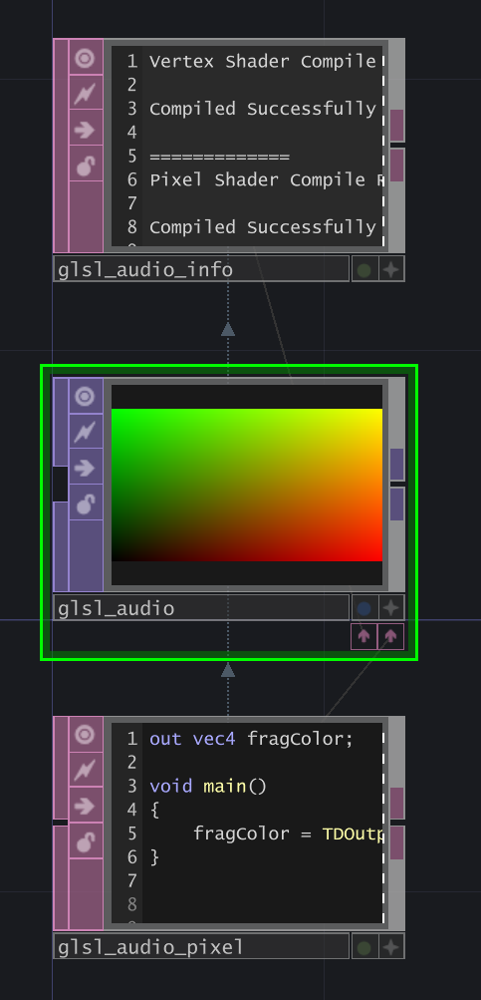
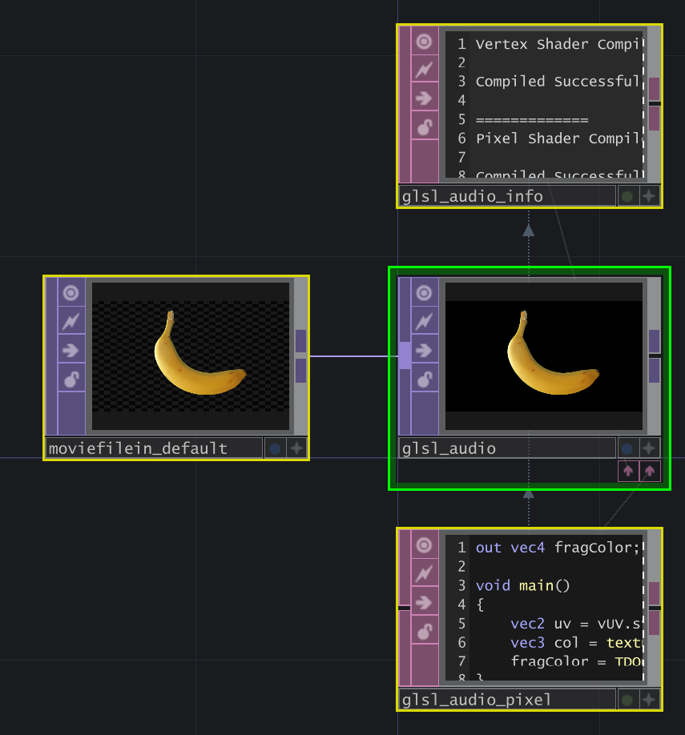
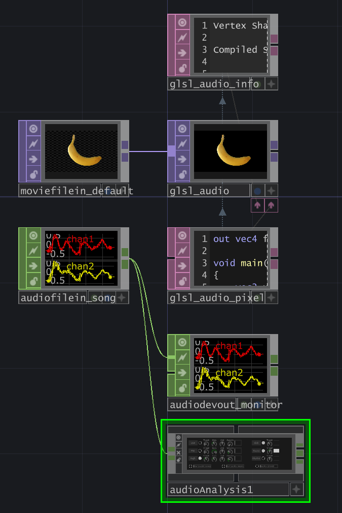
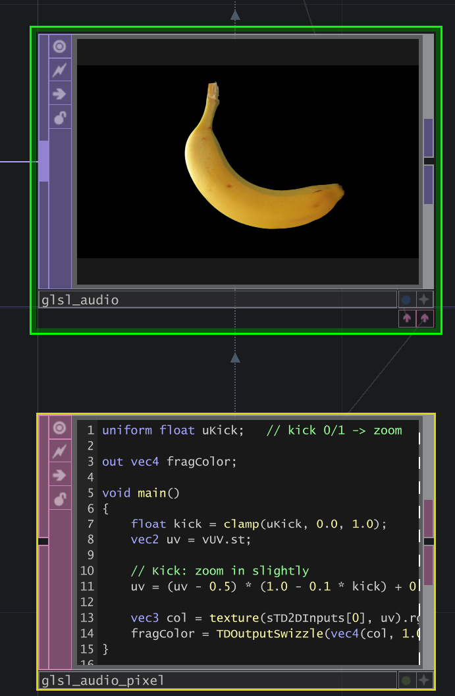
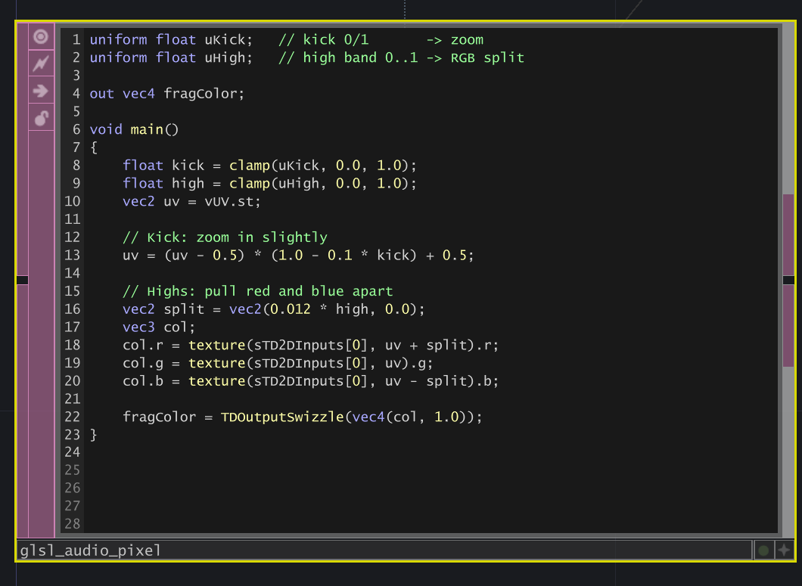
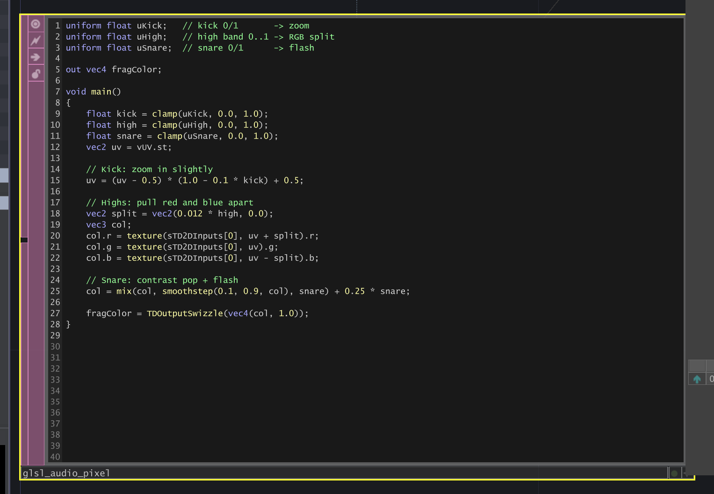
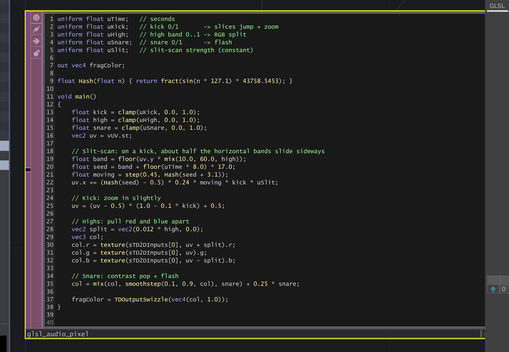
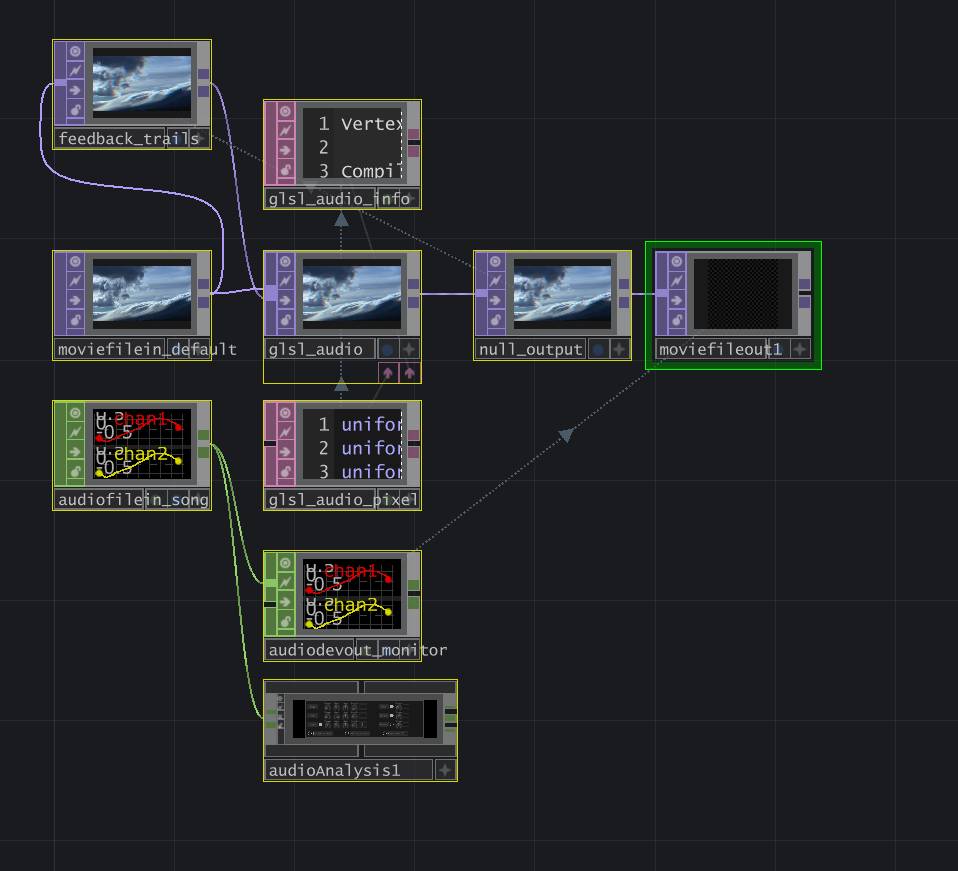

[← All weeks](../)

**Contents**

<!-- prettier-ignore -->
* TOC
{:toc}

## 📝Brief

_Over the semester, we've been working with one design tool to improve our technical capabilities. This week: set a new SMART goal with that tool, make a plan for execution, and work to grow your skills further. Document the goal, the process, and the outcome._

---

## 🧭Why TouchDesigner

My [last](../week-3-teach-me-teach-you/) [two](../week-4-trust-the-process/) rounds of tool learning were in the music programming language [Strudel](https://strudel.cc/). I've documented my beef with its learning curve and UI already, so I won't feed a fed horse (being eco-friendly in the spirit of this week's reading).

Instead, I'm pivoting to [TouchDesigner](https://derivative.ca/). I used it a lot in undergrad and during a stint at a film studio in LA, so I'm starting from a decent place, but there's a LOT to learn. My biggest gap is shaders. We've started them in Creative Code, but writing GLSL inside TouchDesigner, driven by CHOP data, is something I've never done. I'm especially drawn to glitch effects (torn, sliced, color-split images), and those live almost entirely in shaders.

## 🎯The SMART Goal and Plan

> Build audio-reactive glitch effects in TouchDesigner: a GLSL pixel shader that glitches an image, with its uniforms (parameters) driven by audio analysis data, in two hours.

|                |                                                                                               |
| -------------- | --------------------------------------------------------------------------------------------- |
| **Specific**   | At least three glitch effects (slices, color split, flash), each tied to a band of the music. |
| **Measurable** | Compiles clean, each effect visibly fires on its band, recorded with audio.                   |
| **Achievable** | I know TD already; the Palette handles the audio math.                                        |
| **Relevant**   | Shaders are my biggest gap, and glitch is the look I want to make.                            |
| **Time-bound** | Two hours before next class.                                                                  |

As far as the plan goes, I wanted to make sure I carry forth the "one tinker at a time" mentality from [Week 4](../week-4-trust-the-process/#part-4-the-practice); in other words, do small steps and make sure they all work before moving on:

1. A bare GLSL TOP compiles and puts something on screen.
2. An image passes through the shader untouched.
3. Audio analysis is running, and the kick, snare, and high channels move with the song.
4. One audio channel visibly drives one uniform.
5. The glitch effects go in, one at a time.
6. It's tuned so each hit reads with the music.
7. It's recorded.

Also, using TouchDesigner's documentation and ShaderToy (among other shader resources) is the key here.

## 🛠️Process

### 1. Something on screen

I started with a GLSL TOP whose pixel shader just paints each pixel's UV coordinates as color. This is basically the shader version of "hello world":


_UVs as color. (0, 0) is bottom-left in TD._

One interesting thing with TouchDesigner is it has a unique function called `TDOutputSwizzle` basically for cross-platform management and a few other things, [so had to learn about and use it via the docs](https://docs.derivative.ca/Write_a_GLSL_TOP#Output_Swizzle). Also, to get the image itself, [there's a built-in function called `sTD2DInputs`](https://docs.derivative.ca/Write_a_GLSL_TOP#Sampling_Inputs) that gets data input into the TOP.

### 2. An image passes through

Next, a Movie File In TOP wired into the GLSL TOP's first input, and a shader that does nothing but sample the input texture and export it back out:


_Input and output match._

### 3. Audio analysis running

For the audio, TD's sample song goes into an Audio File In CHOP, out to the speakers through an Audio Device Out, and into the built-in **audioAnalysis** component. That component does the hard part (splitting the sound into bands and detecting hits) and spits out channels like `kick`, `snare`, and `high`. Its own docs recommend turning on only what you need, so just Kick, Snare, and High are active for me.

The useful surprise was the _shape_ of the data. `high` is a smooth level that spikes on hi-hats and cymbals, but `kick` and `snare` are on/off: a flat 1 for about a tenth of a second on each hit, then straight back to 0. That helped me decide that hits are triggers, not fade-offs. However, if I did want to make them fade-offs, TouchDesigner does have a Lag CHOP for this exact purpose.


_The song feeds the speakers and audioAnalysis._

### 4. One channel drives one uniform

On the GLSL TOP's **Vectors** page, I then created a uniform (passed-in parameter) called `uKick`, which directly pulls data from a channel in the audio analysis via some Python in `op('audioAnalysis1/out1')['kick']`.

The effect initially did was:

```glsl
uv = (uv - 0.5) * (1.0 - 0.1 * kick) + 0.5;
```


_The image punches in on each kick._

### 5. Glitch effects, one at a time

#### Color split (highs)

I bound `uHigh` the same way, then had the shader read the image three times: red nudged right, green in place, blue nudged left. The highs set how far apart, so cymbals fringe the edges red and blue (chromatic aberration, like a cheap lens).

```glsl
vec2 split = vec2(0.012 * high, 0.0);
col.r = texture(sTD2DInputs[0], uv + split).r;
col.g = texture(sTD2DInputs[0], uv).g;
col.b = texture(sTD2DInputs[0], uv - split).b;
```

Since `high` is smooth, the split breathed with the cymbals instead of snapping.


_Red and blue pull apart on the highs._

#### Flash (snare)

`uSnare` got a one-liner: a contrast boost (`smoothstep`) plus a brightness bump, only while the snare hit.

```glsl
col = mix(col, smoothstep(0.1, 0.9, col), snare) + 0.25 * snare;
```


_The frame pops brighter on each snare._

#### Slit-scan (kick)

The centerpiece, and the most new-to-me as far as GLSL code goes. I cut the image into horizontal bands and shoved about half of them sideways on each kick. Shaders don't have a `random()`, so I used a "hash" to scramble number I chose into something that _looks_ random.

```glsl
float Hash(float n) { return fract(sin(n * 127.1) * 43758.5453); }

float band = floor(uv.y * mix(10.0, 60.0, high));
float seed = band + floor(uTime * 8.0) * 17.0;
float moving = step(0.45, Hash(seed + 3.1));
uv.x += (Hash(seed) - 0.5) * 0.24 * moving * kick * uSlit;
```

`band` numbers each strip (more strips when the highs are up), `seed` reshuffles them 8 times a second, `moving` picks about half, and the last line shoves those left or right, only on a kick. That added two more uniforms: `uTime` and `uSlit` (a strength knob).


_Strips jump sideways on each kick._

### 6. Echo trails and tuning

With everything working, it felt choppy: every effect happened _on_ a hit and then vanished. So I went off-plan and added echo trails.

A shader can't read its own last frame, so a **Feedback TOP** did it for me, looping `null_output` back in as the shader's second input:

```glsl
vec3 prev = texture(sTD2DInputs[1], vUV.st).rgb;
float fb = clamp(uFeedback, 0.0, 0.98) * (1.0 - 0.6 * kick);
col = max(col, prev * fb);
```

The key detail is `vUV.st` (untouched coordinates) instead of `uv` (already glitched).


_The Feedback TOP hands back the previous frame._

**Where it broke: the trails ate the glitch.** The slices looked weak because `max()` let the old, unshifted frame ghost back into the gaps. Doubling `uSlit` and shortening the trails (`uFeedback` 0.9 → 0.8) fixed it.

**Cutting the zoom.** The kick zoom plus outward-streaming trails made everything pulse. I wanted it to glitch _in place_, so both went.

**Swapping the flash for tears.** The flash felt like a blinding strobe, which I didn't like I wanted glitch _bands_, so the snare now tears thin vertical columns, and the color split only hits glitched bands.

**Where it broke: the random numbers stopped being random.** The tears never showed. `Hash()` evidently was shitting the bed once big numbers got involved, and `uTime` (TD's absolute clock) was in the thousands, so every column got the same "random" answer. Wrapping time with `mod()` fixed it, and had probably been quietly killing the kick bands too:

```glsl
float seed = band + mod(floor(uTime * 8.0), 64.0) * 17.0;
```

## 🎵Outcome

Did I accomplish this? **Yes**, though I overshot the time and it took closer to two and a half hours. The shader compiles clean, and each "band" has its own glitch effect.

<video src="img/audio-glitch-shader.mp4" poster="img/audio-glitch-shader.jpg" controls playsinline preload="none"></video>
_Sound on. Kicks slide bands, snares tear columns, highs split the color._


_Image on top, audio below, one GLSL TOP._

<details class="contraband" markdown="1">
  <summary>How the network works</summary>
  <div class="body" markdown="1">

```
moviefilein_default ─────────────────────→ glsl_audio → null_output
feedback_trails (last frame of null_output) ─┘
audiofilein_song → audioAnalysis1 → (read by the uniforms)
```

Each uniform on the GLSL TOP's Vectors page is an expression reading the audio, like `op('audioAnalysis1/out1')['kick']`. `feedback_trails` points at `null_output`, so input 1 is always the previous frame. Drop a different file onto `moviefilein_default` to change the image.

**glsl_audio**: glitch bands + echo trails

```glsl
uniform float uTime;      // seconds
uniform float uKick;      // kick 0/1       -> horizontal bands jump + tear color
uniform float uHigh;      // high band 0..1 -> thinner bands + light RGB split
uniform float uSnare;     // snare 0/1      -> vertical column tears
uniform float uSlit;      // glitch strength (constant)
uniform float uFeedback;  // trail length 0..0.98 (constant)

out vec4 fragColor;

float Hash(float n) { return fract(sin(n * 127.1) * 43758.5453); }

void main()
{
	float kick  = clamp(uKick,  0.0, 1.0);
	float high  = clamp(uHigh,  0.0, 1.0);
	float snare = clamp(uSnare, 0.0, 1.0);
	vec2 uv = vUV.st;

	// Kick: about half the horizontal bands slide sideways
	float band = floor(uv.y * mix(10.0, 60.0, high));
	// mod() keeps the seed small: sin() in Hash breaks down on huge numbers
	float seed = band + mod(floor(uTime * 8.0), 64.0) * 17.0;
	float moving = step(0.45, Hash(seed + 3.1)) * kick;
	uv.x += (Hash(seed) - 0.5) * 0.24 * moving * uSlit;

	// Snare: a few thin vertical columns tear up or down
	float column = floor(uv.x * 24.0);
	float cSeed = column + mod(floor(uTime * 12.0), 64.0) * 31.0;
	float tearing = step(0.7, Hash(cSeed + 9.7)) * snare;
	uv.y += (Hash(cSeed) - 0.5) * 0.12 * tearing * uSlit;

	// Color split: light everywhere on the highs, strong inside glitched bands
	float glitched = max(moving, tearing);
	vec2 split = vec2(0.012 * high + 0.03 * glitched, 0.0);
	vec3 col;
	col.r = texture(sTD2DInputs[0], uv + split).r;
	col.g = texture(sTD2DInputs[0], uv).g;
	col.b = texture(sTD2DInputs[0], uv - split).b;

	// Echo trails: last frame, in place.
	// Uses the untouched vUV so the glitch doesn't pile up frame after frame.
	vec3 prev = texture(sTD2DInputs[1], vUV.st).rgb;
	float fb = clamp(uFeedback, 0.0, 0.98) * (1.0 - 0.6 * kick);
	col = max(col, prev * fb);

	fragColor = TDOutputSwizzle(vec4(col, 1.0));
}
```

  </div>
</details>

## 💭Reflection

TODO
