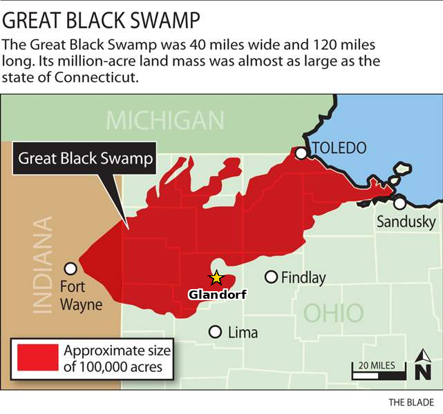
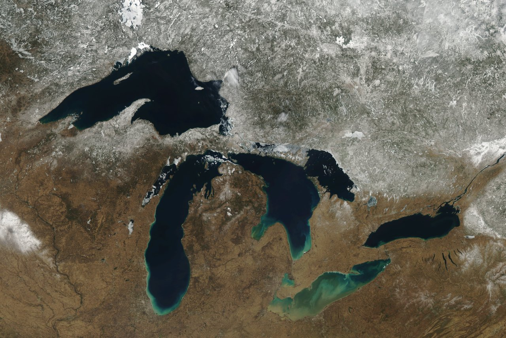
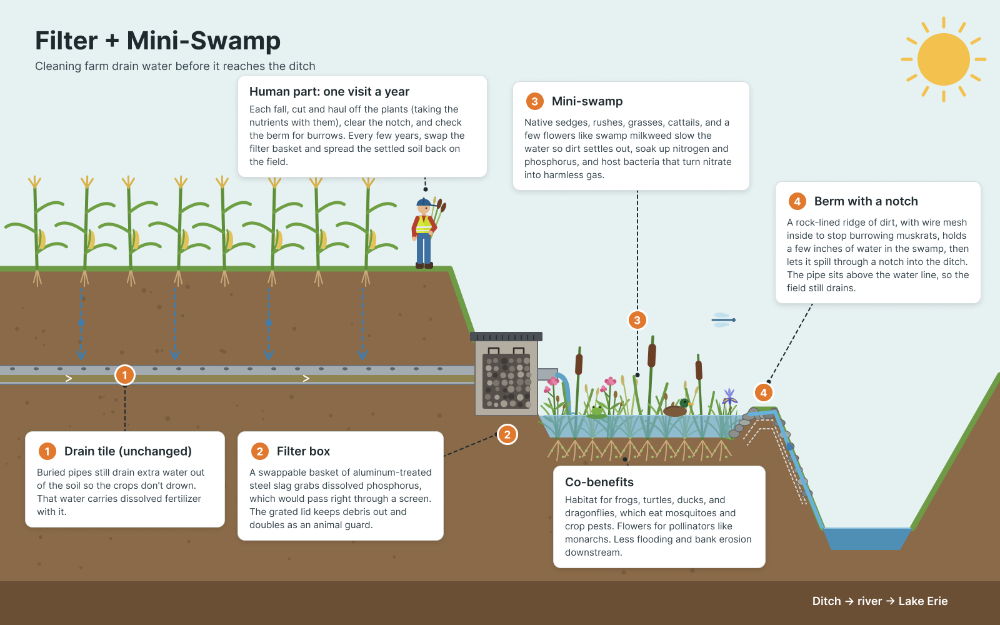

[← All weeks](../)

**Contents**

<!-- prettier-ignore -->
* TOC
{:toc}

## 📝Brief

_Design a device or idea that addresses an ecosystem service concern:_

- **Choose a concern:** _Pick an ecosystem service from the reading, or identify your own (dog poop, durable carbon sequestration, clean water, car exhaust, heat stress, etc.). Choose one primary service to repair or augment; extra benefits are great, but have one main focus._
- **Sketch it (in class):** _Quick sketches of how the idea might work. It can be simple, even a refinement of an existing idea. Ideally it's feasible (no breaking the laws of physics), though it's fine to involve chemistry or processes you're unfamiliar with. Ideally it's a "hybrid": some human intervention and engineering, plus a modicum of biological ingredients (no slavery, please). Check sketches against peers and gather feedback._
- **Illustrate it (before next week):** _What makes the idea awesome? Is it small or large, a personal device or something built by the department of transportation? Create a higher-resolution illustration, rendering, or physical model, annotated with explanatory notes. Consider:_
  - _Is there a precedent for this device?_
  - _Why would people want it? Cheaper, better, easier, faster, cooler, healthier?_
  - _Any "co-benefits," such as summer shading, making the owner money, or being edible?_

_Post the sketches and final illustrations here._

---

## 🌱The Concern: The Great Black Swamp

Northwest Ohio (where I'm from) used to be a huge wetland known as the [Great Black Swamp](https://en.wikipedia.org/wiki/Great_Black_Swamp), which held water and filtered it before it reached Lake Erie. However, it was drained for farmland in the late 1800s, and today most of those fields are "tiled" with buried pipes that drain the soil into ditches, which feed creeks and smaller rivers, then the Maumee, then the lake. Water that used to sit in the swamp for weeks now runs off the fields in hours, carrying fertilizer with it, and the phosphorus in that fertilizer feeds toxic algae blooms. Every summer, western Lake Erie turns into a gross algae-filled mess that wrecks the lake's ecosystem. In August 2014, one of those blooms made [Toledo's tap water undrinkable](https://www.michiganpublic.org/environment-science/2014-08-04/toledo-mayor-lifts-water-ban) for more than 400,000 people for three days. Crazy stuff.

{: width="641" height="600"}
_The extent of the Great Black Swamp, made by the Toledo Blade. My hometown of Glandorf, OH is labeled on the map._

{: width="1280" height="856"}
_From space, Lake Erie often looks full of mud/algae compared to the other Great Lakes._

I want to bring back the swamp's water filtering. I was just home in Glandorf this past week (family obligations). It used to be part of the swamp and is still a very rural farming community, so it's been on my mind.

## ✏️Initial Sketches

I missed the in-class sketch session for those same family obligations, so I sketched on my own. Here was my original idea:

{: width="1551" height="1500"}

A lot of ditches back home already feel like they're trying to reclaim some wetlands, full of cattails and reeds. That's mostly by accident, since ditches are wet, sunny, and full of fertilizer. They do filter a little, but ditches are often cleaned/mowed to keep the water moving, which wipes out the plants and stirs the trapped dirt and phosphorus back up.

My idea takes that accidental swamp and makes it intentional. Instead of the tile pipe dumping straight into the ditch, it empties into a small planted shelf (the "mini-swamp") built into the ditch bank, above the main channel. The water has to sit and work its way through the plants before it spills into the ditch, and since the shelf sits above the channel, the county can keep cleaning out the ditch without wrecking it. It doesn't rebuild the whole swamp (which would mean un-farming Northwest Ohio), just the swamp's cleaning function.

## 💬Feedback

Since I missed in-class feedback too, I asked Pierce to take a look:

> I really like this idea. It addresses pollutants in water that often go overlooked, despite their significant role in contributing to algal blooms and the loss of native species. I would encourage you to take the concept a step further by exploring the question: How can we make this solution practical and accessible enough that people will actually implement it? I would also recommend elaborating on the co-benefits of the approach, highlighting not only its environmental impact but also the additional ecological, social, or economic advantages it could provide. This could help strengthen the case for adoption and demonstrate the broader value of your concept.

So I dug deeper into both its practicality and its co-benefits.

## 🖼️The Concept: Filter and Mini-Swamp

{: width="1600" height="1000"}

**▶️ Click-through walkthrough** (click or press → to bring in each step):

<iframe
  style="border: 1px solid rgba(0, 0, 0, 0.1); width: 100%; aspect-ratio: 16 / 11;"
  src="https://embed.figma.com/proto/rhsROigj2FA96me2kl3y5A/Week-11---Sketch-Design-Green-Machines?node-id=12-249&p=f&scaling=contain&content-scaling=fixed&page-id=12%3A248&starting-point-node-id=12%3A249&hotspot-hints=0&embed-host=share"
  allowfullscreen>
</iframe>

[Open the walkthrough in Figma ↗](https://www.figma.com/proto/rhsROigj2FA96me2kl3y5A/Week-11---Sketch-Design-Green-Machines?node-id=12-249&p=f&scaling=contain&content-scaling=fixed&page-id=12%3A248&starting-point-node-id=12%3A249&hotspot-hints=0) · [Open the design file ↗](https://www.figma.com/design/rhsROigj2FA96me2kl3y5A)

### ⚙️How It Works

1. Nothing changes in the field; the buried tile still drains extra water out of the soil so the crops don't drown, and that water still carries dissolved fertilizer with it.
2. At the end of the pipe, the water passes through a filter basket. I originally sketched a "big coffee filter", but I learned the phosphorus is dissolved in the water, so a filter alone would let it right through. The basket needs to be full of material the phosphorus actually sticks to, like aluminum-treated steel slag (plain slag tends to clog up with tile water). A grated lid keeps debris out, and doubles as an animal guard so muskrats can't crawl up into the tile.
3. The water spills onto the mini-swamp, a shelf planted with a mix of native wetland plants, such as sedges, rushes, grasses, cattails, and a few flowering ones like swamp milkweed. The plants slow the water down so dirt settles out, and soak up nitrogen and phosphorus as they grow. Their roots also host bacteria that turn nitrate into harmless nitrogen gas.
4. A berm (a low ridge of dirt) along the edge of the shelf holds a few inches of water in the swamp. Once the water gets deep enough, it spills through a notch in the berm into the ditch, then on to the river and the lake. The berm and notch are lined with rock, with wire mesh buried inside, so burrowing animals can't tunnel through it. The pipe sits above that water line, so the field still drains.

The human part is mostly one visit a year. Each fall, the county or township (or the farmer, or a criminal assigned to community service) cuts and hauls off the plants, which pulls the nutrients they soaked up out of the system for good, clears any junk out of the notch, and checks the berm for burrows. Every few years, the full filter basket gets swapped, and the settled dirt gets scraped out and spread back on the field it came from.

### 🏛️Precedent

I'd never seen one, but there's already something called a [two-stage ditch](https://en.wikipedia.org/wiki/Two-stage_drainage_ditch): a ditch dug with a flat, planted shelf on each side of the main channel, so high water spreads out over the plants and the ditch needs less dredging. One was dug on the Niese Joint County Ditch in Putnam County (where Glandorf, OH is) in 2016, a joint project of the county's Soil & Water Conservation District, The Nature Conservancy, Ohio State, and the USDA ([case study](https://www.nature.org/content/dam/tnc/nature/en/documents/niese-oedy-two-stage-ditch-case-study.pdf)).

[H2Ohio](https://h2.ohio.gov/) already pays to build two-stage ditches and wetlands across Northwest Ohio. The new part is putting them together at the end of every tile drain, so the field's water gets treated before it ever reaches the ditch.

Phosphorus filters already exist too. Ohio State and USDA researchers tested one filled with aluminum-treated steel slag on a farm in Mercer County, and it caught about a quarter of the dissolved phosphorus and half of the total ([study](https://experts.umn.edu/en/publications/performance-of-a-ditch-style-phosphorus-removal-structure-for-tre/)).

This concept combines all three.

### 🎁Benefits

It helps both people and nature:

1. Safer drinking water for the millions of people who rely on Lake Erie.
2. A cleaner lake, healthier for aquatic wildlife and for people who swim, fish, and do watersports in it.
3. It cleans up nitrogen too, not just phosphorus. Nitrate in drinking water is its own health problem, but bacteria on the plant roots turn nitrate into harmless gas.
4. The mini-swamps double as habitat for frogs, turtles, ducks, and dragonflies in the middle of corn and soybean country, and a lot of those animals work for the farmer by eating insects and rodents. Northwest Ohio is also on a major bird migration route along Lake Erie, so thousands of little wet patches could work as rest stops between the lakeshore marshes.
5. Pollinators get a boost too. A few flowering natives in the planting mix, like swamp milkweed (which monarch caterpillars feed on) and blue flag iris, turn each mini-swamp into a patch of pollinator habitat at no extra cost.
6. Less flooding. Slowing the water down at every outlet means a smaller surge downstream after big storms, which means less flooding, less bank erosion, and a little less mud in the rivers.
7. A short-term investment with long-term payoffs for a lot of people:
   1. The county spends less on dredging ditches that aren't filling up with mud.
   2. The topsoil and phosphorus scraped out of the swamp go back on the field, so the farmer keeps some of the fertilizer they paid for.
   3. Cities spend less treating algae-filled water.
   4. Much less money has to be spent on cleaning up Lake Erie.
8. It's measurable. Each used filter basket can be tested for how much phosphorus it caught, giving each farm proof of what it kept out of the lake. That's exactly the kind of evidence a voluntary approach needs (more on that [below](#making-it-practical)).

### 🚜Making It Practical

Pierce's big question was how to get people to actually build these, which is fair: a good design doesn't matter if nobody builds it. Here are the pushbacks I'd expect from a farmer or the county, and how the design handles each:

1. **Will it back water up into the field?** Farmers tile their fields so water gets off fast, and anything that might back water up into the tile is a non-starter. That's why the pipe empties above the swamp's water line, and the notch in the berm sets how high that water can ever get. If the basket clogs or a big storm overwhelms it, the water just spills over the top onto the shelf. Worst case, the water skips the filter, not the field.
2. **How much crop ground does it take?** The mini-swamp is a narrow strip along the ditch bank, which is usually too wet to farm well anyway, and along county ditches that strip is often already kept clear for maintenance. The 1,500-foot Niese two-stage ditch only needed about an acre of seeding. For the ground it does take, Ohio's [Lake Erie CREP](https://fsa.usda.gov/sites/default/files/documents/crep_lake_erie_watershed-3.pdf) already pays farmers to turn strips of cropland along waterways into filter strips and wetlands, so that land still earns something.
3. **What does it cost to build?** Digging the shelf is the same kind of work a county already does when it cleans out a ditch, and H2Ohio's [two-stage ditch grants](https://spectrumnews1.com/oh/columbus/news/2022/08/16/h2ohio-grant-for-two-stage-ditches) can cover up to the full cost of building one in Northwest Ohio. For reference, the Niese ditch came out to about $17 a foot. The filter basket could be a standard, off-the-shelf unit that fits common tile sizes, so installing one is closer to swapping a part than designing a wetland. And slag is a leftover from making steel, so the filter material itself is cheap.
4. **Who keeps it up?** Upkeep is what kills a lot of conservation projects, so this needs to stay off the farmer's to-do list. Ohio counties and/or townships (mine is Pleasant Township) already maintain a lot of the drainage ditches, paid for by the landowners along them. The mini-swamps could ride on that same program: the county or township builds them while it's already working on a ditch, does the fall cutting when crews are already out mowing, and swaps the filter baskets every few years. Two-stage ditches also barely fill up, only 1-13 mm of sediment over their lifetime ([Ohio State](https://agbmps.osu.edu/bmp/open-channeltwo-stage-ditch-nrcs-582)), so they rarely need cleaning out. The farmer doesn't have to learn anything new or show up with a shovel.
5. **Does it actually do enough?** Most of the phosphorus leaves fields in a handful of big spring storms, before the plants have really started growing, and a small swamp can't catch everything in a downpour. So this isn't a fix on its own. The filter works year-round and the swamp still lets dirt settle out in spring, but it works best alongside farmers putting less fertilizer on in the first place. Still, it adds up: the Niese ditch alone removes about 120 lbs of phosphorus a year. It also makes sense to start with the leakiest fields instead of every outlet at once, since about 5% of fields in the region have soil phosphorus at 2.5 times the recommended max ([study](https://www.frontiersin.org/articles/10.3389/fsufs.2021.742817/full)).
6. **Won't the swamp eventually fill up with phosphorus and leak it back out?** That's what the fall harvest and the occasional scrape-out are for: both physically take the phosphorus out, instead of just storing it in the mud. Fall cattail harvests in Manitoba pulled out about 27-54 lbs of phosphorus per acre each year ([study](https://mspace.lib.umanitoba.ca/items/08ba6c3d-6560-4bb5-82d3-270d645781c9)).
7. **What about animals?** Putting a wetland next to a field will attract wildlife. Most of it is good news: frogs and dragonflies eat mosquitoes and crop pests, and the owls, hawks, and snakes that come to hunt keep mice and voles down. Deer and raccoons are already all over the fields anyway, so a strip of plants doesn't change much. The real problems are muskrats and groundhogs, which dig into banks and can make a berm leak or collapse, and red-winged blackbirds, which nest in cattails and are a known corn pest near the Lake Erie marshes. The design handles both: the water is only a few inches deep (muskrats like it [two to three feet deep](https://publications.mgcafe.uky.edu/sites/publications.ca.uky.edu/files/for51.htm)), the berm is rock-lined with wire mesh inside, the pipe has an animal guard, and the planting is mostly sedges and grasses instead of a solid stand of cattails. And because the water keeps moving and the frogs and dragonfly larvae eat mosquito larvae, it's much less of a mosquito spot than a stagnant puddle.

Finally, there's a reason for farmers to get ahead of this. In 2023, the U.S. EPA approved a [phosphorus limit for the Maumee watershed](https://www.epa.gov/system/files/documents/2023-09/maumee-watershed-nutrient-tmdl-faqs.pdf) that calls for a 40% cut, but for farms it still leans on voluntary practices. Showing that voluntary fixes like this one work is the best argument against stricter rules later.

## 💭Reflection

_What I learned._
