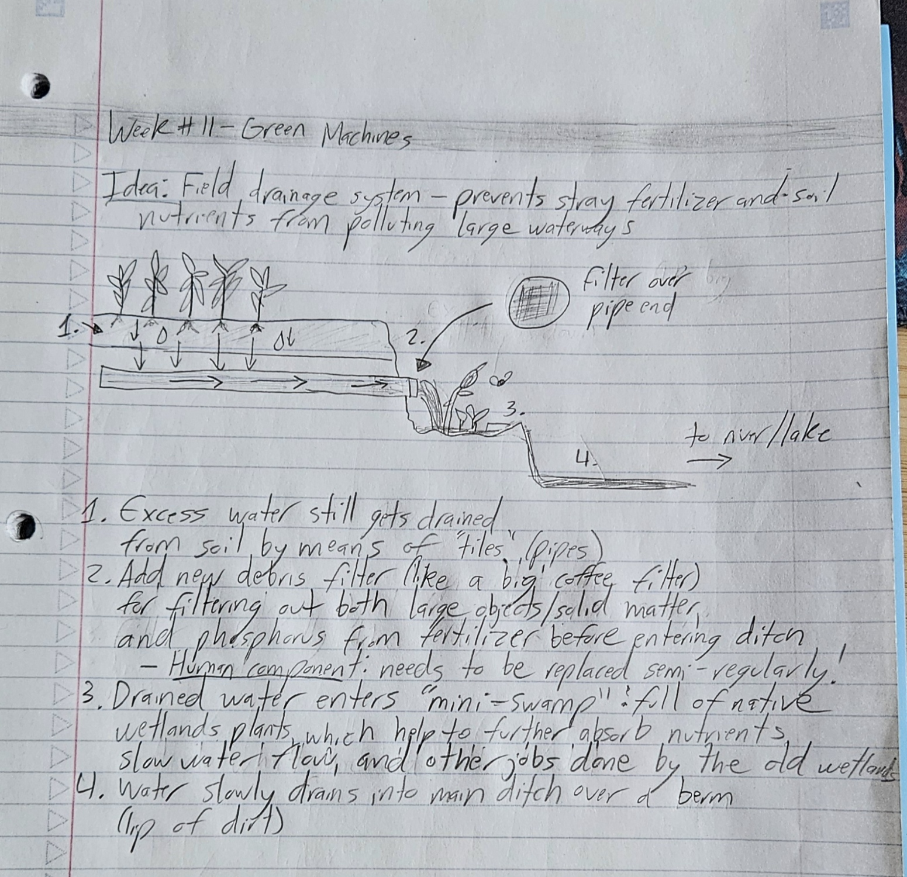

[← All weeks](../)

**Contents**

<!-- prettier-ignore -->
* TOC
{:toc}

## 📝Brief

_Design a device or idea that addresses an ecosystem service concern:_

- **Choose a concern:** _Pick an ecosystem service from the reading, or identify your own (dog poop, durable carbon sequestration, clean water, car exhaust, heat stress, etc.). Choose one primary service to repair or augment; extra benefits are great, but have one main focus._
- **Sketch it (in class):** _Quick sketches of how the idea might work. It can be simple, even a refinement of an existing idea. Ideally it's feasible (no breaking the laws of physics), though it's fine to involve chemistry or processes you're unfamiliar with. Ideally it's a "hybrid": some human intervention and engineering, plus a modicum of biological ingredients (no slavery, please). Check sketches against peers and gather feedback._
- **Illustrate it (before next week):** _What makes the idea awesome? Is it small or large, a personal device or something built by the department of transportation? Create a higher-resolution illustration, rendering, or physical model, annotated with explanatory notes. Consider:_
  - _Is there a precedent for this device?_
  - _Why would people want it? Cheaper, better, easier, faster, cooler, healthier?_
  - _Any "co-benefits," such as summer shading, making the owner money, or being edible?_

_Post the sketches and final illustrations here._

---

## 🌱The Concern: The Great Black Swamp

Northwest Ohio (where I'm from) used to be a huge wetland known as the [Great Black Swamp](https://en.wikipedia.org/wiki/Great_Black_Swamp), which had the ecological benefit of holding water and filtering it before it reached Lake Erie. However, it was drained for farmland in the late 1800s, and today most of those fields are "tiled" with buried pipes that drain the soil into ditches, which feed into various creeks/estuaries/smaller rivers, then the Maumee River, then finally the lake itself. Water that used to sit in the swamp for weeks now runs off the fields in hours, carrying fertilizer with it, and the phosphorus in that fertilizer feeds toxic algae blooms. Thus, every summer, western Lake Erie turns into a gross algae-filled mess, which has had significant impacts on the lake's ecosystem. In August 2014, one of those blooms made [Toledo's tap water undrinkable](https://en.wikipedia.org/wiki/2014_Toledo_water_crisis) for about half a million people for three days. Crazy stuff.

_The extent of the Great Black Swamp, made by the Toledo Blade. My hometown of Glandorf, OH is labeled on the map._

I want to bring back the water-filtering effect the swamp used to do. I was just in my hometown of Glandorf, OH this past week (family obligations), which used to be part of the swamp, so it's pretty present on the mind. Especially since it's a very rural and farming-based community.

## ✏️Initial Sketches

Since I missed the in-class sketch session due to the aforementioned family obligations, I did it on my own. Here's what my original idea for taking on this problem was:

A lot of ditches back home already feel like they're trying to reclaim some wetlands, full of cattails and reeds. That's mostly by accident, since ditches are wet, sunny, and full of fertilizer. They do filter a little, but ditches are often cleaned/mowed to keep the water moving, which wipes out the plants and stirs the trapped dirt and phosphorus back up.

My idea takes that accidental swamp and makes it intentional. Instead of the tile pipe dumping straight into the ditch, it empties into a small planted shelf (the "mini-swamp") built into the ditch bank, above the main channel. The water has to sit and work its way through the plants before it spills into the ditch, and since the shelf sits above the channel, the county can keep cleaning out the ditch without wrecking it. It doesn't rebuild the whole swamp (which would mean un-farming northwest Ohio), just the swamp's cleaning function.

## 💬Feedback

Since I wasn't in class to get feedback during that, I asked Pierce to take a look. Here's what he said:

> I really like this idea. It addresses pollutants in water that often go overlooked, despite their significant role in contributing to algal blooms and the loss of native species. I would encourage you to take the concept a step further by exploring the question: How can we make this solution practical and accessible enough that people will actually implement it? I would also recommend elaborating on the co-benefits of the approach, highlighting not only its environmental impact but also the additional ecological, social, or economic advantages it could provide. This could help strengthen the case for adoption and demonstrate the broader value of your concept.

Based on this, I figured it'd be worth diving deeper both into its practicality and additional benefits.

## 🖼️The Concept: Filter and Mini-Swamp

**▶️ Click-through walkthrough** (click or press → to bring in each step):

<iframe
  style="border: 1px solid rgba(0, 0, 0, 0.1); width: 100%; aspect-ratio: 16 / 11;"
  src="https://embed.figma.com/proto/rhsROigj2FA96me2kl3y5A/Week-11---Sketch-Design-Green-Machines?node-id=12-249&p=f&scaling=contain&content-scaling=fixed&page-id=12%3A248&starting-point-node-id=12%3A249&hotspot-hints=0&embed-host=share"
  allowfullscreen>
</iframe>

[Open the walkthrough in Figma ↗](https://www.figma.com/proto/rhsROigj2FA96me2kl3y5A/Week-11---Sketch-Design-Green-Machines?node-id=12-249&p=f&scaling=contain&content-scaling=fixed&page-id=12%3A248&starting-point-node-id=12%3A249&hotspot-hints=0) · [Open the design file ↗](https://www.figma.com/design/rhsROigj2FA96me2kl3y5A)

### ⚙️How It Works

The numbers match my sketch:

1. Nothing changes in the field. The buried tile still drains extra water out of the soil so the crops don't drown, and that water still carries dissolved fertilizer with it.
2. At the end of the pipe, the water passes through a filter basket. My sketch called it a big coffee filter, but the phosphorus from fertilizer is dissolved in the water, so a screen alone would let it right through. The basket needs to be full of material the phosphorus actually sticks to, like steel slag. A grated lid keeps debris out, and doubles as an animal guard so muskrats can't crawl up into the tile.
3. The water spills onto the mini-swamp, a shelf planted with a mix of native wetland plants: mostly sedges, rushes, and grasses, with some cattails. The plants slow the water down so dirt settles out, soak up nitrogen and phosphorus as they grow, and their roots host bacteria that turn nitrate into harmless nitrogen gas. Keeping it a mix instead of pure cattails makes it less attractive to red-winged blackbirds (more on that [below](#making-it-practical)).
4. A berm (a low ridge of dirt) along the edge of the shelf holds a few inches of water in the swamp. Once the water gets deep enough, it spills through a notch in the berm into the ditch, then on to the river and the lake. The berm and notch are lined with rock, with wire mesh buried inside, so burrowing animals can't tunnel through it. The pipe sits above that water line, so the field still drains.

The human part is mostly one visit a year. Each fall, the farmer (or the county Soil & Water Conservation District) cuts and hauls off the plants, which pulls the nutrients they soaked up out of the system for good, clears any junk out of the notch, and checks the berm for burrows. Every few years, the filter basket gets swapped once it's full, and the dirt that's settled in the swamp gets scraped out and spread back on the field it washed off of.

### 📏Scale

One mini-swamp per tile outlet, sized to the field it drains. It's farm-scale: bigger than a personal device, smaller than a public works project. A single farmer could build one, and a county could build thousands along its ditches. Each one is a tiny slice of swamp, but together they start to add back up to the Great Black Swamp.

### 🏛️Precedent

None of the pieces are new. The mini-swamp is basically a small version of a two-stage ditch, which is a ditch dug with a flat, planted shelf on each side of the main channel, so high water spreads out over the plants and the ditch needs less dredging. Ohio State and The Nature Conservancy have built some in the Maumee watershed. Phosphorus filters using steel slag have been tested on Ohio farms by USDA researchers, and the state's [H2Ohio](https://h2.ohio.gov/) program already pays farmers to build wetlands and adopt practices like these. The new part is putting them together at the end of every tile drain, so the field's water gets treated before it ever reaches the ditch.

### 🙋Why People Would Want It

Farmers mostly care about cost and hassle, so the pitch is that it's cheap and nearly hands-off. Cost-share programs like H2Ohio can cover much of the install, there are no moving parts, and the upkeep is one fall visit. The dirt scraped out of the swamp is topsoil that washed off the field, so it goes right back where it came from. And since 2014, farmers in the region have taken a lot of the blame for the algae blooms, so this is a visible way to be part of the fix. For everyone else, it means cleaner drinking water for Toledo and every other town that pulls from Lake Erie.

### 🚜Making It Practical

Pierce's big question was how to get people to actually build these, which is fair, since a good design doesn't matter if nobody builds it. The main thing is keeping it off the farmer's to-do list as much as possible.

Ohio counties already maintain a lot of the drainage ditches, paid for by the landowners along them. The mini-swamps could be built into that same program, so the county installs them when it's already out working on a ditch, and the fall harvest happens when crews are already mowing. The farmer doesn't have to learn anything new or show up with a shovel.

The parts should be off-the-shelf, too. The filter basket could be a standard unit that fits common tile sizes, so installing one is closer to swapping a part than designing a wetland, and replacing it is just lifting out the old basket and dropping in a new one.

Paying for it is the last hurdle. H2Ohio already funds wetlands and conservation practices, so the install could be mostly covered. And the mini-swamp only takes a narrow strip along the ditch bank, which is usually too wet to farm well anyway, so the farmer isn't giving up good crop ground.

The other thing a farmer would ask about is animals, since putting a wetland next to a field will attract wildlife. Most of it is good news: frogs and dragonflies eat mosquitoes and crop pests, and the owls, hawks, and snakes that come to hunt keep mice and voles down. Deer and raccoons are already all over the fields anyway, so a strip of plants doesn't change much. The real problems are muskrats and groundhogs, which dig into banks and can make a berm leak or collapse, and red-winged blackbirds, which nest in cattails and are a known corn pest near the Lake Erie marshes. The design handles both: the water is only a few inches deep (muskrats like it deeper), the berm is rock-lined with wire mesh inside, the pipe has an animal guard, and the planting is mostly sedges and grasses instead of a solid stand of cattails. Because the water keeps moving and the frogs and dragonfly larvae eat mosquito larvae, it's also much less of a mosquito spot than a stagnant puddle.

### 🎁Co-benefits

Ecologically, the mini-swamps double as habitat for frogs, turtles, ducks, and dragonflies in the middle of corn and soybean country, and a lot of those animals work for the farmer by eating insects and rodents. Northwest Ohio is also on a major bird migration route along Lake Erie, so thousands of little wet patches could work as rest stops between the lakeshore marshes. And slowing the water down at every outlet means a smaller surge downstream after big storms, which means less flooding, less bank erosion, and a little less mud in the rivers.

Socially, the big one is safer drinking water for Toledo and every other town that pulls from Lake Erie, so nobody has to repeat 2014. It also gives farmers a visible way to be part of the fix instead of taking the blame. And it brings a bit of the Great Black Swamp back into the landscape that used to be it, which matters to people like me who grew up hearing about it.

Economically, it saves money in a few places. The county spends less on dredging ditches that aren't filling up with mud. The topsoil and phosphorus scraped out of the swamp go back on the field, so the farmer keeps some of the fertilizer they paid for. Cities spend less treating algae-filled water. And a cleaner Lake Erie is good for the fishing and tourism economy along the lakeshore. The harvested plants can be sold or used as mulch, compost, or animal bedding.

## 💭Reflection

_What I learned._
