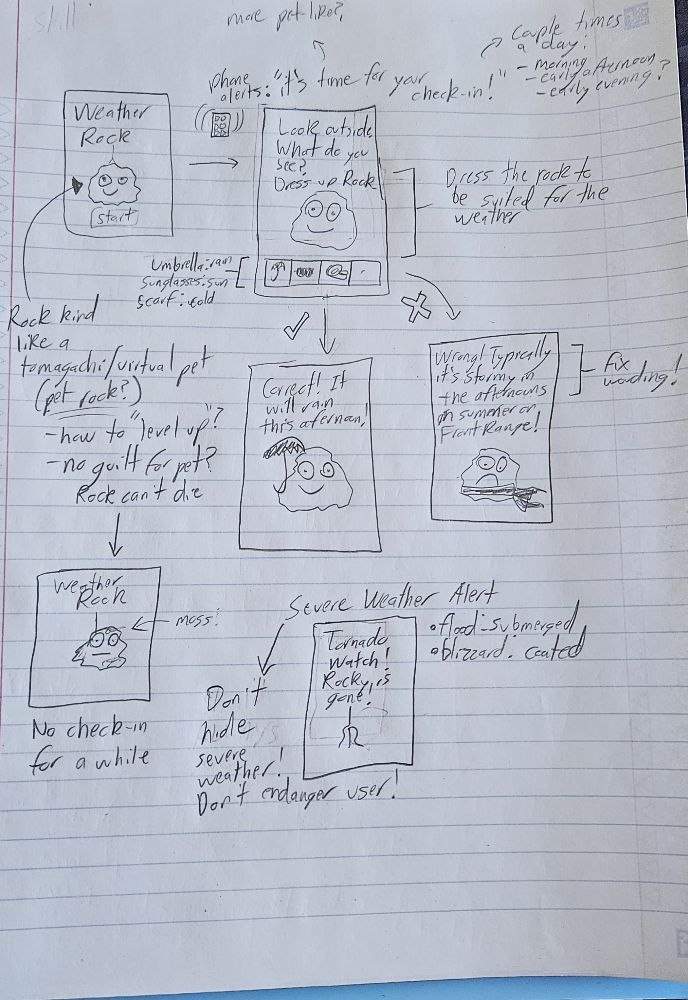

[← All weeks](../)

**Contents**

<!-- prettier-ignore -->
* TOC
{:toc}

## 📝Brief

> ⚠️ I was out of class the day groups formed, so I did this one as an individual exercise.

_Thanks to the miracles of technology, we've extended our capability into the world: navigation, memory, coordination, conversation! And yet, there are those amongst us who desire to take back certain functions from the machine. Develop a prototype application that is built to gradually transfer the cognitive workload back to the user._

_For example, what would a navigation app look like that was trying to teach you how to navigate better via landmarks? Or a camera app that helps you form durable visual memories?_

**Brainstorm:**

1. List tools we use to extend our conscious capabilities.
2. Note which cognitive processes each of those tools lets us offload.
3. Zero in on one cognitive skill someone might want to reclaim.
4. Consider their motivations: what do they really want to gain control over?

**Then:** sketch/prototype concepts for 20 minutes, pick the strongest direction, and build it out as a Figma prototype for presentation next class.

---

## 🧠Brainstorm

I had the benefit of looking at everyone else's presentations before I did this assignment, so I avoided doing any topic another group did: music streaming, social media, cooking/food, language/grammar, etc. Thus, for brainstorming, I came up with:

| Tool                    | What it offloads                                                                           |
| ----------------------- | ------------------------------------------------------------------------------------------ |
| 📇 Contacts             | Phone numbers, birthdays, addresses                                                        |
| 📅 Calendar             | Upcoming events                                                                            |
| ✅ To-do List           | Holding / prioritizing tasks in your head                                                  |
| 🧮 Calculator           | Mental math, estimating                                                                    |
| 🔍 Google search        | Remembering facts ("I'll just look it up")                                                 |
| 🌿 Plant / bird ID apps | Identifying plants, birds, and trees                                                       |
| ⌚ Fitness trackers     | Tracking workouts and diets (calories, protein, etc.); noticing recovery and sleep quality |
| 🌦️ Weather app          | Reading the sky, wind, and seasonal patterns                                               |
| 💰 Budgeting            | Tracking where your money goes; creating budgets and "balancing checkbooks" by hand        |
| ⏰ Clocks / timers      | Sense of time passing, estimating durations                                                |

### 🌦️What I Chose: Weather

Partially for the goofy factor, and partially for the challenge, I chose weather. Not whole-day or future forecasting; after all, we've spent centuries developing technologies and methodologies to "predict" the weather and still do a pretty mediocre job. Instead, more short-term observations tied to when you need it. For example, looking at the sky and based on seasonal weather trends, will it rain in the next few hours, or can I go on that hike?

The motivation is threefold:

1. _Know more about weather patterns_: For thousands of years, professions like farmers and sailors didn't have access to weather prediction. They had to read the sky and use seasonal weather patterns in their local geography to "predict" what any given day would do. For example, the [phrase](https://en.wikipedia.org/wiki/Red_sky_at_morning) "Red sky at night, sailors' delight; Red sky at morning, sailors take warning" was invented to be a sort of weather-prediction idiom.
2. _Have a greater connection to your local surroundings_: Using a weather app is having your face on a screen instead of in the world around you; this app would force you to look at the sky, observe nature, and generally get a little more in touch with the world. To use meme lingo, it'd help you "touch grass", which IMO is especially relevant and important along the Front Range.
3. _Be self-reliant when technology isn't there_: Out on a trail with no signal, a weather app can't tell you that the clouds stacking up over the mountains mean lightning by 2pm. Forecasts are also made for a whole region, not the exact spot you're standing in an hour from now. Being able to read the sky yourself means you can make the call to turn around (or keep going) on your own.

### 🪨Weather Rocks

When I decided on weather, I immediately thought of [weather rocks](https://en.wikipedia.org/wiki/Weather_rock), which was honestly kind of a meme before memes were a thing (see [this website](https://myweatherrock.com/weather-rock), for example). In Boy Scouts, our camps often had weather rocks as a joke, and I've seen it used elsewhere for similar reasons. Essentially, it's a rock that's hung up with a list of rules, typically like:

> - If the rock is wet, it's raining.
> - If the rock is swinging, the wind is blowing.
> - If the rock casts a shadow, the sun is shining.
> - If the rock does not cast a shadow and is not wet, the sky is cloudy.
> - If the rock is difficult to see, it is foggy.
> - If the rock is white, it is snowing.
> - If the rock is coated with ice, there is a frost.
> - If the ice is thick, it's a heavy frost.
> - If the rock is bouncing, there is an earthquake.
> - If the rock is under water, there is a flood.
> - If the rock is warm, it is sunny.
> - If the rock is missing, there is a tornado.
> - If the rock is wet and swinging violently, there is a hurricane.
> - If the rock can be felt but not seen, it is night time.
> - If the rock has white splats on it, watch out for birds.
> - If there are two rocks, you're drunk.

_Source: Wikipedia._

The rock boasts a "100% success rate", since it only reports what's happening currently. Which, while being "haha silly rock joke", has some actual application. The principle of a weather rock is essentially "just look around", which is what I want the app to help someone do for their own weather forecasting.

Also, another "humorous" concept related to rocks is [pet rocks](https://en.wikipedia.org/wiki/Pet_Rock), which are literally just rocks that you pretend are pets. Combining these two ideas, I came up with the idea of having the app be a "virtual pet" (think a [Tamagotchi](https://en.wikipedia.org/wiki/Tamagotchi)), where you check in and predict the weather to help care for your "pet weather rock".

## ✏️20-Minute Sketch

_My 20-minute sketches for Weather Rock: the check-in loop, right/wrong results, no check-in, and the severe weather alert._

I wanted to lean heavily into the "virtual pet" with this, so making the driving approach "caring" for the rock feeds into the usage of the app. Visually, it should also reflect the "weather rock" rules above; i.e., after predicting, a rock should be covered in snow if it is snowing.

**What the sketch figured out:**

- Dressing up the rock _is_ the prediction: umbrella = rain, sunglasses = sun, scarf = cold, etc. It's much more engaging than a dropdown or text-based quiz.
- Check-ins happen a couple of times a day (morning, early afternoon, early evening), with a phone alert.
- The rock can't die. If there's no check-in for a while, it just gets mossy. No guilt!
- Right/wrong results show up on the rock: smiling under an umbrella when you called the rain, or sad and cold when you didn't.
- Severe alerts break through no matter what, which is where "if the rock is missing, there is a tornado" comes in ("Rocky is gone!"). These should reflect the weather rock rules for severe weather: a flood leaves it submerged, a blizzard leaves it coated in ice, etc.

**Open questions:** There are a few other apps that use virtual pets to drive a larger purpose (for example, [Finch](https://finchcare.com/) for self-care), so I'll need to do some research about how apps like that work. Some questions I still have:

- _Tamagotchis_ have growth stages (baby, child, teen, adult); presumably we want something similar to show progression of weather-reading skill.
- How do we make a rock compelling, and/or give it a personality? It should feel more pet-like than it does in the sketch.
- This is essentially gamifying the weather, and gamification can get obsessive; I wouldn't want this to turn into something like Duolingo. How do we make the app engaging and fun, but also simple and not overbearing?
  - Some things I'd want to avoid: streaks, leaderboards, in-app purchases, etc.
- What happens if there's multiple types of weather? I.e., what if it rains at 2pm, but is sunny at 3pm?

## 📱Prototype for Weather Rock

**▶️ Clickable prototype:**

<iframe
  style="border: 1px solid rgba(0, 0, 0, 0.1); width: 100%; height: 700px;"
  src="https://embed.figma.com/proto/BJuLdXW24TB3eIOg1KjOYT/%E2%9B%85Weather-Rock%F0%9F%AA%A8?node-id=37-2&p=f&scaling=scale-down&content-scaling=fixed&page-id=0%3A1&starting-point-node-id=42%3A30&embed-host=share"
  allowfullscreen>
</iframe>

[Open the prototype in Figma ↗](https://www.figma.com/proto/BJuLdXW24TB3eIOg1KjOYT/%E2%9B%85Weather-Rock%F0%9F%AA%A8?node-id=37-2&p=f&scaling=scale-down&content-scaling=fixed&page-id=0%3A1&starting-point-node-id=42%3A30)

**🔀 Flows:**

| Flow                                                                                                                                                                                                                            | What it shows                                                      |
| ------------------------------------------------------------------------------------------------------------------------------------------------------------------------------------------------------------------------------- | ------------------------------------------------------------------ |
| [🌅 Main Flow](https://www.figma.com/proto/BJuLdXW24TB3eIOg1KjOYT/%E2%9B%85Weather-Rock%F0%9F%AA%A8?node-id=37-2&p=f&scaling=scale-down&content-scaling=fixed&page-id=0%3A1&starting-point-node-id=42%3A30)                     | The daily check-in: dress up your rock, then see if you were right |
| [🐣 Sign-up](https://www.figma.com/proto/BJuLdXW24TB3eIOg1KjOYT/%E2%9B%85Weather-Rock%F0%9F%AA%A8?t=aQrrptgWm78VWqr8-0&scaling=scale-down&content-scaling=fixed&starting-point-node-id=103%3A607&show-proto-sidebar=1)          | Adopting and naming your rock                                      |
| [🌪️ Tornado Warning](https://www.figma.com/proto/BJuLdXW24TB3eIOg1KjOYT/%E2%9B%85Weather-Rock%F0%9F%AA%A8?t=aQrrptgWm78VWqr8-0&scaling=scale-down&content-scaling=fixed&starting-point-node-id=120%3A1057&show-proto-sidebar=1) | "If the rock is missing, there is a tornado"                       |
| [🌊 Flash Flood](https://www.figma.com/proto/BJuLdXW24TB3eIOg1KjOYT/%E2%9B%85Weather-Rock%F0%9F%AA%A8?t=aQrrptgWm78VWqr8-0&scaling=scale-down&content-scaling=fixed&starting-point-node-id=125%3A1069&show-proto-sidebar=1)     | "If the rock is under water, there is a flood"                     |
| [🎓 Graduation](https://www.figma.com/proto/BJuLdXW24TB3eIOg1KjOYT/%E2%9B%85Weather-Rock%F0%9F%AA%A8?t=aQrrptgWm78VWqr8-0&scaling=scale-down&content-scaling=fixed&starting-point-node-id=131%3A1402&show-proto-sidebar=1)      | Your rock retires to the windowsill                                |

**🎨 Design file (all screens):**

<iframe
  style="border: 1px solid rgba(0, 0, 0, 0.1); width: 100%; height: 600px;"
  src="https://embed.figma.com/design/BJuLdXW24TB3eIOg1KjOYT/%E2%9B%85Weather-Rock%F0%9F%AA%A8?node-id=0-1&embed-host=share"
  allowfullscreen>
</iframe>

[Open the design file in Figma ↗](https://www.figma.com/design/BJuLdXW24TB3eIOg1KjOYT/%E2%9B%85Weather-Rock%F0%9F%AA%A8?node-id=0-1)

### 💡The Idea

> _A pet rock that teaches you to read the sky, until you don't need it._

The basic idea is that, a few times a day, your pet rock asks what the sky looks like. You go outside and use information around you (the sky, the trees, the wind, etc.), and dress it for the weather you think is coming. In the early stages, it tells you right away how your call compares to the forecast, but in the later stages it waits to tell you (nature doesn't tell you what it's going to do!). Either way, it checks back later with what actually happened, compared against real-life weather data. Over time the app gives you less help, until it's basically just an actual weather rock.

#### 🐣Sign-up

To really sell the idea of "adopting" a pet rock, it's treated like a pet. It comes from a carrying container (like pet rocks did in the 70s and 80s), and you can name/choose a "stone type" (color) for your rock. The idea being, someone would care for their own personal rock.

#### 🌅Daily Check-ins

The user sets up three daily check-ins: one in the morning, one in early afternoon, and one in early evening. The times are configurable, so a user can adjust when they happen based on their schedule.

A check-in works as follows:

1. **Notification:** Your rock "wants to know what the sky looks like."
2. **Guessing the weather:** Two options:
   1. **Sky:** Pick all the weather you expect over the next few hours: ☔ rain, 😎 clear, ☁️ cloudy, ⛑ storms, 🧣 snow, 🪁 windy.
   2. **Temperature:** a slider for how warm it'll feel over the next few hours.
3. **What tipped you off?:** Tag some cues behind your call: for example, "🍃 leaves flipping to show their undersides", "☁️ clouds building over the horizon", "🌬️ wind shifting east", "👃 smells like rain". This is how the Journal learns which of your instincts to trust.
4. **Result** _(Stages 1 and 2 only)_**:** Your rock reacts appropriately if you matched or missed the forecast. A card underneath lines up your call ("Rain · feels like 68°") against the forecast ("70% chance of rain, 1–3 pm · 66°"), plus the cue you trusted or missed ("Clouds stacking over the horizon"). It closes with when your rock will check back: "I'll check what actually happened at 4 pm."
   - From Stage 3 on, there's no forecast to compare against, so there's no result screen. You make your call and that's it. Once the real weather data comes in, the call shows up in the Journal marked ✓ Right or ✗ Missed, next to what actually happened ("Rain moved in at 11:40"). The real-life weather data (not the forecast, which is wrong sometimes too) would come from the same public sources forecasters use: NWS station observations, radar rainfall estimates for your exact spot, etc.
   - At every stage, only what actually happened counts. If you and the forecast both called rain and it stayed dry, that's a miss, and your rock tells you so: "Stayed dry. The forecast missed this one too."

Missing a check-in is fine. "Can't look right now" snoozes it for an hour, since the whole point is actually looking outside, not guessing from your desk. If you miss it entirely, it quietly expires when the next one comes around. Skipped check-ins don't count as wrong, because polish only looks at calls you actually made. Skip a few days in a row and your rock gets a little mossy, which wipes off the next time you check in. No streaks, no guilt.

#### 🏠Home and Tabs

The tabs are where the learning happens:

- **🏠 Home:** Your rock, today's check-ins, and its top three skills (how "polished" you are at calling each kind of weather).
- **📓 Journal:** Your past calls, what actually happened, and your most reliable cue.
- **🔍 Cues:** Things to look for, rated _science-backed_, _folklore_, or _myth_. Debunking myths (cows lying down before rain) makes the app more credible. Each cue opens a short lesson.
- **🪨 Rock:** Tumbling progress, polish for every kind of weather, and how close your temperature calls have been.

#### 🪨Tumbling: Handing the Work Back

This is the part that answers the brief. Real rocks get polished by tumbling, so your rock goes from a rough boulder to a polished pocket stone as you improve, and the app helps less at each stage:

| Stage | Rock                  | What the app does                             | Check-ins                                            |
| ----- | --------------------- | --------------------------------------------- | ---------------------------------------------------- |
| 1     | Rough boulder         | Shows the forecast and cues up front          | 3 a day, with hints; 3 sky options; within 8° counts |
| 2     | Cobble                | You guess first, then see the forecast        | 3 a day; all sky options; within 5°                  |
| 3     | Pebble                | No forecast; checks you against reality later | Morning only; within 3°                              |
| 4     | Polished pocket stone | Only confirms what you report, after the fact | None; you open the app yourself; within 3°           |

You level up on accuracy, not activity. A condition's "polish" (score) is how often you got it right the last 10 times you either called it or it actually happened. Every kind of weather (rain, wind, snow, etc.) gets its own score, checked against real weather data. Temperature gets its own polish too: a call counts as right if your slider lands within that stage's margin (8° at Stage 1, down to 3° by Stage 3). Once the conditions you see regularly and your temperature calls all hit 8 of the last 10, your rock moves up a stage.

The cues you tag don't affect your score; instead, they go to the Journal, which shows which of your instincts actually pay off. For example, "You're right 9 of 10 times when you tag clouds building".

#### 🎓Graduation

Unlike most pet apps, which try to keep you around forever, this one has an ending. Once fully polished, your rock says "I think you've got this," shows your record, and retires to your windowsill. The app goes quiet and a **real** weather rock arrives in the mail as a reward.

#### 🚨Severe Weather

Since the app shouldn't put anyone in danger by withholding information, severe weather alerts are displayed to the user. This includes tornadoes, blizzards, floods/flash floods, etc. The alert itself comes straight from the NWS for your location, and it breaks through at every stage, even Stage 4. Alerts never count toward your score, so there's no reason to step outside and "check" during a tornado.

## ⏭️Next Steps / Taking It Further

Because I'm only one person doing a group project, I wasn't able to flesh out the prototype and mockups as much as I would've liked to. However, since I want to "chase the idea further" for a goofy concept like this:

- **Pet actions:** Things you'd do with a real pet, rock edition. "Walk your rock" uses your phone's pedometer to track your walks/hikes, and it counts as a bonus check-in - meant to incentivize you to further "touch grass". Also, commands like "Sit," "Stay," and "Play dead" that your rock can "obey".
- **Night mode:** An after-dark check-in with its own cues, like a ring around the moon (rain is often a day or so out) or a clear, calm sky (expect a colder morning, maybe frost). The app switches to a dim night theme so it doesn't wreck your night vision, and since "if the rock can be felt but not seen, it is night time," your rock also gives a little buzz when you tap it.
- **Travel pause:** When you're far from home, check-ins pause automatically. Nothing counts against you and your rock doesn't get mossy.
- **Regional cue packs:** Cues tied to where you live: afternoon storms building over the mountains, sea breezes and marine fog on the coast, etc. New cues unlock with the seasons, like summer thunderstorms or the first fall frost.
- **Weather instruments:** Teach you to read the same tools sailors and farmers used: a barometer (most phones have one built in), a wind vane, a rain gauge, and more. Your check-in could include "the pressure's dropping" or "wind's out of the east" as cues, read by you, not handed to you by the app.

## 💭Reflection

The question with building a prototype is "would I use this?", and to be honest I doubt I would. I wanted this app to be a personal challenge in HOW to possibly offload weather, but at the end of the day when I open my weather app I just want an overview of the temperature and brief overview of the day. I.e., "Should I wear pants or shorts today"? An app like this complicates that process a decent amount. Also, I'm never good with virtual pet / "daily check-in" apps, so my rock would get really mossy quickly.

Another major design question still open is "why would we design the app to be deleted?" I know this is an app mainly for reclaiming cognitive activity, but also if it were to become an actual app, how would it even work for money / profit? There's a reason lots of virtual pet / gamification apps have features like streaks, bonuses, etc.: to keep the player involved every day. An app that's designed around eventual deletion wouldn't really work.

That brings me to my main point of ponder: would this even work to "reclaim" weather-reading capabilities? Obviously, I didn't do any testing of this, so I have no idea if it'd do what it's expected to do. One of the readings on prototypes talks about the three types, so a lot more in-depth prototyping would need to take place to see if this app does what it's expected to.

I did have the benefit of going to class before doing this assignment: I saw other people's presentations, and heard Danny say that "if you're going to do a funny project, chase it further than necessary". Not only did it help narrow down my ideas, it also helped me to really think about all the possibilities of a goofy weather virtual pet app.

This also ties back to [Week #4](../week-4-trust-the-process/), where I argued that some friction is worth keeping. Weather Rock is basically that argument turned into an app: each tumbling stage takes away a little more help, so you're always working at "the edge of what I can do". But it also explains why I probably wouldn't use it. In Week #4, the friction was worth it because I wanted the payoff of playing a song I really like. With weather, there's no payoff like that for me; I just want to know if I should wear pants or shorts. So for me, the app's friction lands in the other category from Week #4: the kind that makes me want to quit before I start. I think the takeaway is that cognitive reloading only works if the person actually wants the skill back, which goes right back to the brief's "what do they really want to gain control over?"
