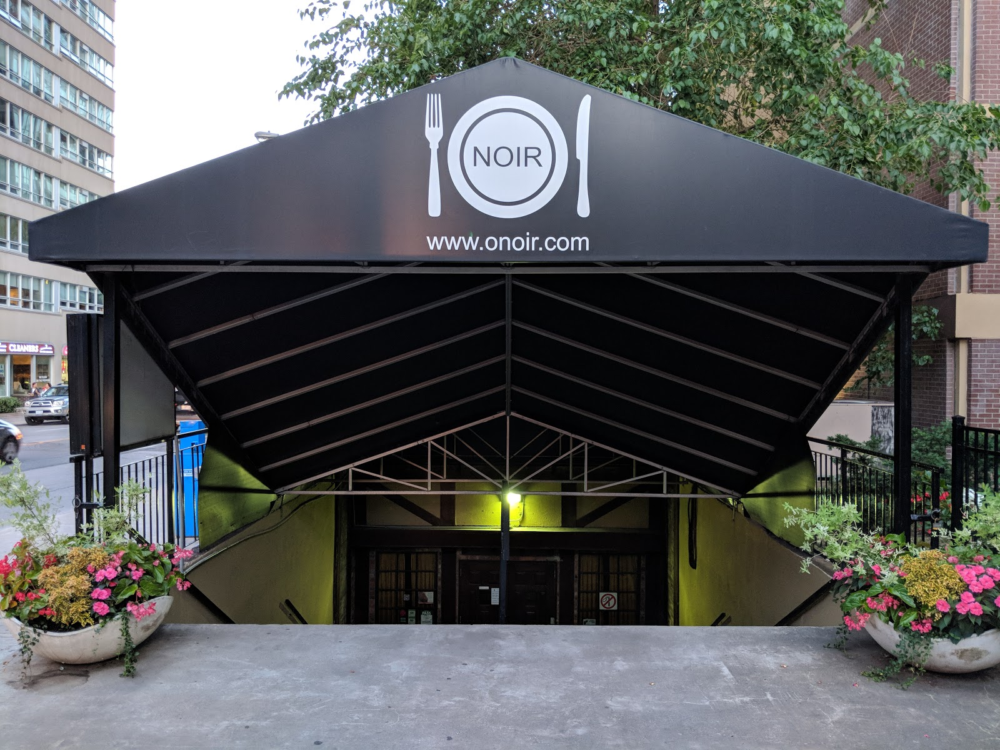
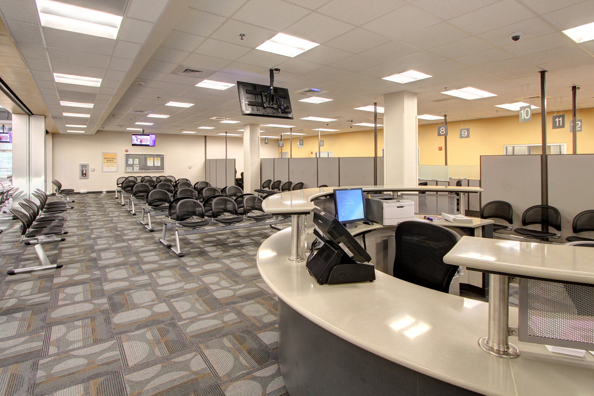
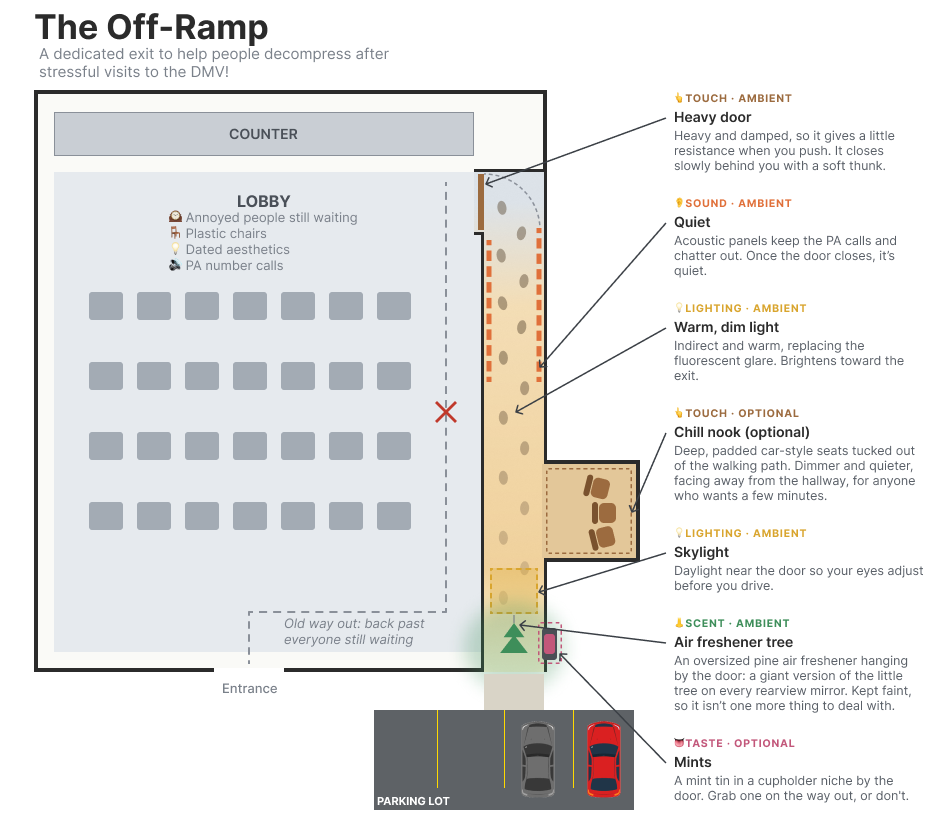
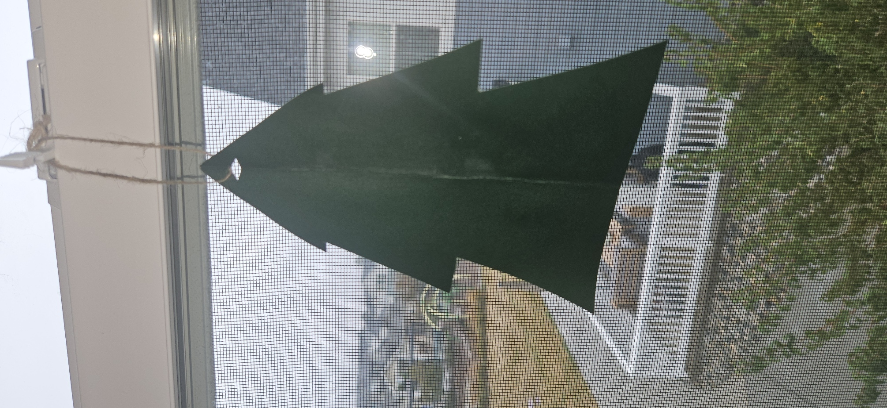
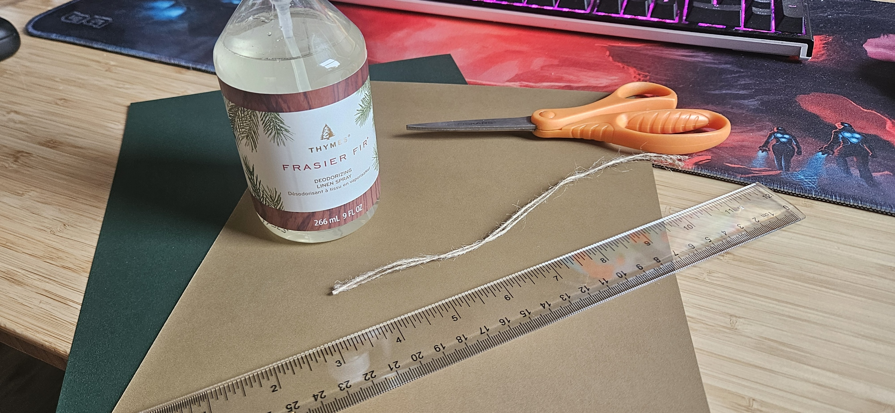
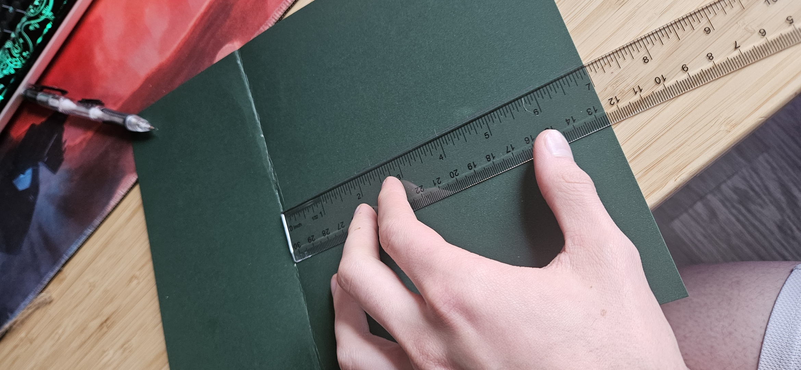
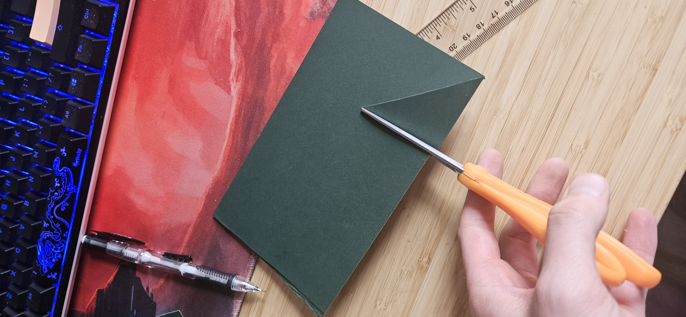
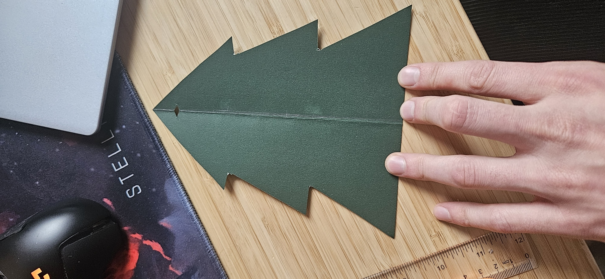
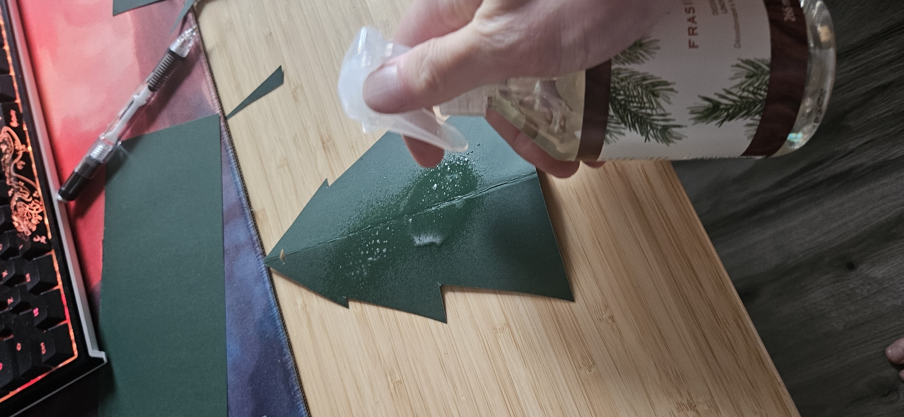
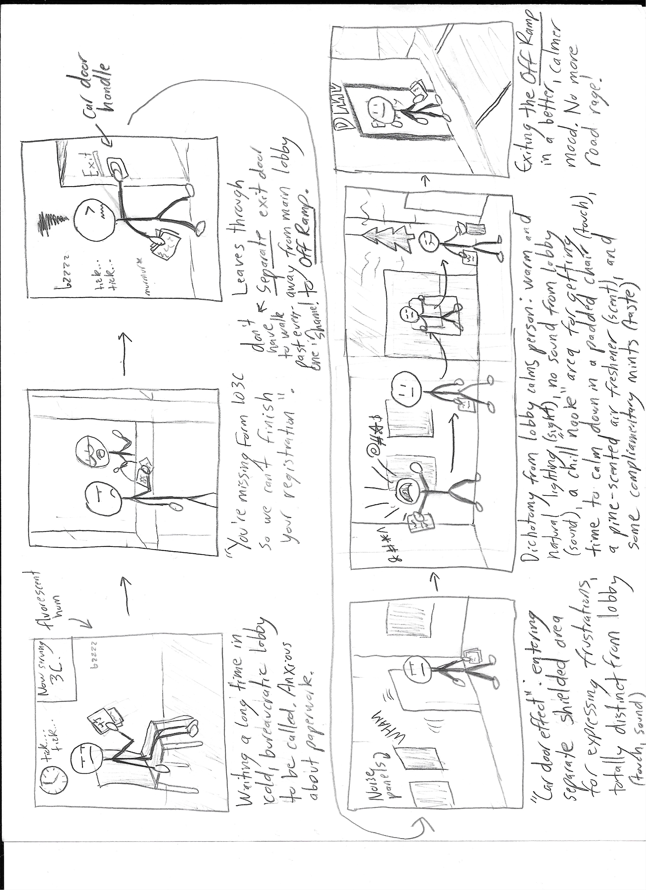

[← All weeks](../)

**Contents**

<!-- prettier-ignore -->
* TOC
{:toc}

## 📝Brief

**Part 1:** _Read Ellen Lupton's_ The Senses _([ProQuest](https://ebookcentral.proquest.com/lib/ucb/detail.action?docID=5348705)), then reflect on a designed experience that wasn't primarily visual, connecting it to the book's chapter on the sense it triggered._

**Part 2:** _Design a public micro-environment that helps overstimulated people decompress in under 5 minutes, using sound, touch, scent, and/or taste (no screens or visual instructions; lighting can support but not guide). Deliver an annotated diagram (look & feel), a sensory prototype of one element (implementation), and a storyboard (role)._

**Part 3:** _Read Chapter 4 of Don Norman's_ The Design of Everyday Things _("Knowing What to Do: Constraints, Discoverability, and Feedback"), then reflect on where the Part 2 concept considered (or should consider more deeply) its constraints and signifiers._

---

## 👅Part 1: O.Noir in Toronto

During a family vacation to Toronto several years ago (I think 2013 or 2014?), we ate at a restaurant called [**O.Noir**](https://www.onoirtoronto.com/). The shtick, as the name suggests if you know some French, is that the dining room is pitch-black. The idea is that losing one sense heightens the others, so the food tastes better. That claim is [often](https://www.allaboutvision.com/resources/human-interest/losing-vision-stronger-senses/) [debated](https://www.scienceabc.com/humans/does-losing-one-sense-improve-the-others), but I'm convinced after visiting; the steak I got there was one of the best I've had in my life.

There are several aspects of the restaurant that build on "blindness":

1. All the servers are visually impaired, so the dark barely affects them, and the people guiding you are the ones most at home in the space. Guests walk in single file (basically a conga line), each holding on to the person in front, with the server leading.
2. There are no in-restaurant menus, so ordering happens entirely by voice, requiring you to pay attention and remember what the server says. There's a menu in the lit-up lobby, but that's also a memory exercise to remember something that you may have looked at over 10 minutes ago.
3. Locations of dishes, silverware, and cups are all specified by "o'clock" position relative to you, which requires deliberate carefulness not to spill, drop things, etc.
   - Even then, I remember they recommended eating with your hands as much as possible, and basically were like "spills happen."
4. There are lots of small rules to ensure darkness unless there's an emergency: no electronics or light sources (unless required), no wandering, the server must guide you to the bathroom, etc.

Each choice hands the work sight normally does over to touch, sound, smell, and taste.

_O.Noir in Toronto, Canada._

### 💭Reflection on the Experience

Lupton's Flavor chapter argues that "flavor is smell" and "flavor is tactile," and the book more broadly says the senses "merge and mingle." So while a "blind" restaurant is mainly about flavor, the whole meal showed how much flavor depends on everything else. Chronologically:

1. _Getting seated_: Our conga line followed the server into the pitch-black seating area. Holding on to the person ahead was the only way to know where we were, which tracks with "touch is spatial." Finding our chairs was "active" touch: reaching out and exploring with our "specialized" hands/fingertips to search for familiar textures/shapes, instead of just bumping into things.
2. _Ordering_: Without menus at the table, ordering took a lot of focus; the reading describes communication as a mix of sound and gesture, but the dark removed the gesture part. Sound also became "synesthetic": a fork clinking against a plate primed me to "see" it, not visually but as a mental picture.
3. _Table talk_: Conversation felt more spatial, since I tracked who was talking by where their voice came from. Without faces or gestures to read, the words needed more attention.
4. _Eating_: This is where the other senses combined their powers, Captain Planet style. People say "you eat with your eyes," but we couldn't use them, so judging the food before and after the first bite fell to everything else:
   - _Smell_: My olfactory bulb picked up the scent of freshly grilled steak: the char, the marinade, etc.
   - _Touch_: My tongue assessed the tenderness I expect from a medium-rare steak, and my fingers felt the juices as I hunted on my plate for the steak.
   - _Sound_: Hearing the juices as I cut pieces of the steak painted a mental picture of it.

O.Noir is built around flavor, but as the Flavor chapter argues, flavor comes from smell, touch, and sound. Taking away sight made each of those contributions impossible to miss, and I think that's why the steak was so memorable and tasty. It was a super cool experience, but I was definitely getting pretty antsy by the end, just due to not being able to see. At the very least, it made me appreciate my sight a little more.

## 🫧Part 2: Decompression Space - DMV "Off-Ramp"

When thinking of public spaces, I pondered where I've felt the most overstimulated in public. One thing immediately jumped to mind: the DMV. I think you'd be hard-pressed to find ANYONE who enjoys the experience at the DMV. It seems specially designed to piss people off: it's slow, bureaucratically bloated, and aesthetically unpleasant.

The DMV has a few different spots of stress:

1. _The lobby_: sitting on an uncomfortable chair under buzzing lights, not knowing if you have everything you need, and anxiously waiting for your number to be called.
2. _The counter_: handing your documents over and waiting while a clerk decides if they're good enough, or a vision test or a photo thrown in on the spot. Worst case, after waiting for hours, you're missing a document or filled out the wrong form and have to come back another day.
3. _Leaving_: walking out still wound up from all that noise and glare, plus whatever happened at the counter. Even a good visit can leave you drained; a bad one leaves you frustrated, short-fused, and already dreading the trip back.

At the DMV, being overstimulated and being frustrated are basically the same feeling: an hour of noise and glare wears you down until one more problem at the counter is enough to tip you over.

Leaving is where there's room to do something about it. It's short (under five minutes), it's a transition from the counter to the car (or bus, or bike, or whatever), and it's the one part of the visit that everyone goes through. Since most people walk out of the DMV and get right behind the wheel, helping someone come down from all that on the way out could make the roads a little safer.

### 🧠Ideation

When you think DMV, you think fluorescent lights, plastic chairs, TVs with queues, cubicles, and bland coloration:

_A typical DMV lobby._

So the starting idea was to subvert all of that, pull in some car inspiration, and avoid the "spa" stereotypes: ambient music, trickling fountains, lavender diffusers, smooth stones, etc.

The car inspiration turned into recreating the relief of getting into your car after a bad day. Slam the door, and you're suddenly in a semi-private spot to express whatever frustrations you have. The idea became a separate exit hallway from the counter to the parking lot that gives you that feeling before you even reach the car, so you never have to walk back through the lobby past everyone still waiting.

Since people leaving just want to get to their car, it can't ask anything of them (no required stops, no interacting, nothing touching them), and it has to work at walking speed. Walking straight through takes about 30 seconds; stopping to vent or sit in the nook can stretch it up to 5 minutes.

### 🗺️Look & Feel: Annotated Diagram

_The Off-Ramp floor plan._

The Off-Ramp is one straight hallway along the building's right wall, running from the counter to the parking lot. A giant padded door with a car door handle seals it off from the lobby, and acoustic panels line the walls, so it's quiet inside and private enough to rage/vent. The light is warm and dim the whole way, with a skylight by the exit, and since it's a single hallway, the light never has to guide anyone anywhere. A giant pine air freshener hangs by the exit too, kept faint so it doesn't overwhelm people. Two things are optional and off to the side (a chill nook and mints); everything else just happens as you walk past it.

### 🛠️Implementation: Sensory Prototype - Giant Pine Air Freshener

At the end of the hall, there's a giant pine air freshener (like many people have in their cars) to really sell the idea of the "car door effect" and help calm individuals. Here's my prototype of this:

_The giant pine air freshener for the sensory prototype._

  
View the making process

  

_The materials: green and tan construction paper, twine, scissors, a ruler, and Thymes Frasier Fir linen spray for the scent._

_Measuring and folding the green construction paper to "plan out" the tree._

_Cutting the tree's outline from the folded edge, so both halves come out matching._

_The unfolded tree, with a hole cut at the top for the twine._

_Spraying the tree with the fir scent._

  

### 🎬Role: Storyboard

_The storyboard of an example person's trip to the DMV and using the Off-Ramp._

My storyboard for this follows a hypothetical guy at the DMV. He's been sitting in the lobby forever, listening to other people's tickets be called, anxiously waiting. However, when he finally gets to the counter, he's told he's missing a form and can't finish his registration there. Great, now he has to come back and do it all over next week. Normally that means walking back through the lobby, past everyone still waiting who saw his mistake. Instead, he grabs the car door handle on the exit by the counter, and the door shuts behind him with a _WHAM_. The PA calls and chatter are gone, so he lets it out: some yelling, some cursing, and nobody in the lobby hears any of it. Once that's out of his system, the hallway starts working on him. It's quiet, the light is warm, and he drops into one of the padded seats in the chill nook for a few minutes. On the way out he passes the giant pine tree, grabs a mint, and walks out into the daylight. He still has to come back, but he isn't taking it out on the drive home.

### 🗣️Class Feedback

I think this project reflected LOTS of personal experience bias, and others brought up some good alternative viewpoints:

- **There's an assumption that someone is a solo person driving their car**: This is the only way I've ever gone to a DMV, but not everyone does this. People often carpool, or take public transit, or ride a bike, to get to the DMV. For example, if my car's registration wasn't complete, I _couldn't_ even drive to the DMV (legally, anyway). This experience needs to reflect the perspectives of people who got to the DMV in other ways. Also, someone who doesn't own a car or drive wouldn't have the "car door" experience or nostalgia. However, to that end, it does give people without a car a private frustration space they wouldn't have.
  - The flipside to that: for people who do have that "car door" experience, is this redundant? I make the point that it's meant to also help alleviate road rage, but also what's to stop someone from just sitting in their car 5 minutes?
- **A single one-way exit misses a lot of considerations**: Making it a single-door exit can be arguably even more embarrassing. People forget things, and if you forgot your water bottle, a form, etc. in the lobby it's a whole awkward trek back inside to grab it, maybe even more awkward than just going back thru the lobby.
- **This is Lobby 2.0**: Fair point; this becomes basically another lobby, with a lot of the same amenities. Relating to the previous point, if you drove someone else to the DMV, where are you supposed to be? Are you supposed to follow them through the door?
- **The worst part of the DMV is the waiting**: I agree with this for sure; part of what makes the frustration of the DMV is, "you forgot Form 1450-X? you have to wait in the lobby for 2 more hours". The DMV should do a better job of either entertaining people or having less waiting, but I think "waiting" isn't exactly "overstimulating" (almost the opposite). Thus, I think alleviating the wait would be good, but a bigger problem than this assignment requires.
- **A loud car door slam could annoy the lobby**: For sure. Probably worth thinking about how to get the "car door" effect without it being annoying to people in the lobby.

### 🤔Responding to the Feedback

Without directly re-doing all the items, I think the next iteration of this space would have the following:

- **Make the space optional**: Make it ONLY if someone wants to exit thru it; don't FORCE someone to exit through it. If someone wants to exit the normal door and get to your car, then let them.
  - This could theoretically just be something you could go to in the lobby directly, rather than getting force-funneled out of the DMV. However, this still makes it Lobby 2.0 (arguably more so) and adds consideration of what happens if your number is called while in it, but would address the feedback.
- **Add multiple exits and make the space a loop**: Basically, add more one-way doors: one to the parking lot, one more direct to a bike rack/bus stop/etc., and one back to the lobby so someone can return there after spending a bit of time there. This also plays into the optionality of the point before.
- **Move the slam inside**: Put a normal, quiet door between the lobby and a small vestibule, then put the car door on the far side of that. The _WHAM_ happens inside the soundproofed hallway, so you still get the satisfying slam, but nobody in the lobby hears it.

## 🚪Part 3: Relating to _The Design of Everyday Things, Chapter 4_

In this chapter, Don Norman mainly talks about constraints, signifiers, and feedback. Relating each of these to the original Off-Ramp, pre-feedback:

- **Constraints**: I think the constraints are the strongest part of the design. Looking at the specific types of constraints:
  - _Physical_: The one-way door is a physical constraint to let people know there's only one way through the door; someone can't go through the wrong side back into the lobby. The hallway itself is one too: it's a single straight line with nowhere else to go.
  - _Cultural_: The car door handle relies on a convention nearly everyone already knows, so no one has to be told how to open it. But someone from a culture where cars aren't common, or someone who doesn't drive a car, may not have this knowledge (which is similar to one point of feedback). The mints work the same way, since a bowl of mints by a door (like at a restaurant host stand, doctor's office lobby, etc.) is commonly understood as "take one", even without a sign. Conventions also cut the other way: it's a convention to keep your voice down in a government building, and without a good signifier letting someone know it's okay to vent here, that convention may undercut the whole point of the Off-Ramp.
  - _Semantic_: The car stuff gives the hallway its meaning. A car door handle and a pine air freshener both "belong" to a car, so together they hint that you should treat the space like your car after a bad day: somewhere private to blow off steam, not somewhere to sit and chat with strangers. Daylight at the far end also reads as "outside," so the only meaningful place for the hallway to end is the exit.
  - _Logical_: The optional things (the nook and mints) sit off to the side, out of the walking path, so the layout itself says you can skip them.
- **Signifiers**: This is definitely the weakest part. Part of the prompt is "no signs", so we can't explicitly say what the room is for, so because of that, the room doesn't do a great job of conveying purpose; that might be evidence it could be considered a "Lobby 2.0", since someone would see chairs, mints, etc. and assume it's another waiting area. The best non-visual signifier available is probably sound. Norman talks about sounds as signifiers, and the sudden quiet when the door seals could be the thing that says "you're ok to raise your voice". Sound panels on the wall can be a visual signifier of this too, albeit a less obvious one.
- **Feedback**: I think the "car door slam" does a lot of heavy lifting for feedback, since like a car door, hearing that noise confirms you're sealed off. Also, the skylight and pine smell near the exit act as feedback that you're almost out. What's missing is feedback _before_ committing: nothing tells you the door is one-way until it's already shut behind you, which is exactly why the forgotten water bottle scenario stings.

Since this sprint was about the senses, it's worth noting how smell and taste fit in, since Norman's examples are almost all sight, touch, and sound. Smell is slow, it lingers, and you stop noticing it after a bit, so it can't confirm a specific action the way a slam can; it works better as an ambient signifier for a place, which is why the pine tree goes at the exit. Taste can't signify anything ahead of time, since you have to commit before you taste, so the mints end up as closing feedback: a small "you're done" before walking outside.

Relating this back to my feedback and possible iterations:

- The looped version from my feedback response makes signifiers harder: with three doors and no signs, each door would need to signal where it goes on its own. Since visual indicators are off the table, each door could lean on a different sense: the parking lot door keeps the car door handle and pine smell, the bus/bike door lets in a little street noise, and the door back to the lobby gets a plain, normal handle.
- Moving the "car door slam" past a quiet vestibule, rather than making it the entrance, keeps the same feedback without the noise reaching the lobby. It's still a real door closing behind you, just the second one instead of the first. If it ever turned into a standalone "rage machine" instead of an actual door, though, it would stop being feedback that you're sealed off and become something you slam just for the release.

## 💭Reflection

I was
