[← All weeks](../)

**Contents**

<!-- prettier-ignore -->
* TOC
{:toc}

## 📝Brief

**Part 1:** _List (with images) examples found of three design phenomena:_

- **False affordance:** _something that signified it should be used one way, but on interaction, turned out to need a different physical interaction._
- **Augmented signifier:** _evidence that the natural signifiers failed and had to be modified after the fact to more clearly indicate the affordance._
- **Forcing function:** _a physical constraint that forces a particular interaction from the user._

**Part 2:** _Prototype a response to each example. For each, sketch at least 4 concepts (no matter how rough), then refine one using any tools:_

- **False affordance:** _two storyboards, one documenting the current interaction and one imagining an improved interaction with as minimal an intervention as possible. Consider multisensory solutions._
- **Augmented signifier:** _a visual rendering of an alternative design that removes the need for the augmentation._
- **Forcing function:** _imagine the scenario that required this design, and recount it as a visual narrative._

_Include sketches, the refined final concepts, and brief descriptors of each._

---

## 🔍Part 1: Examples in the Wild

### 🚪False Affordances

_What each one signified, and what interaction it actually needed._

{: .examples}
| Sliding steel flap |
| --- |
| <video src="img/steel-flap-door-demo.mp4" poster="img/steel-flap-door.jpg" controls muted playsinline preload="none"></video> |
| This is a weather flap that protects some USB plugs from the elements. I think that it does have a correct affordance in that it can be slid up, as well as having a hole at the bottom to protect the plug but allow the cord to still go through. However, sliding it too far makes it fall off, which kills the whole point of protecting the ports from the elements. |

### 🏷️Augmented Signifiers

_Which natural signifier failed, and how it was patched._

{: .examples}
| Hazard tape step | Stop engine sign | Cardboard recycling bin | Courteous sign | Storm drain cover |
| --- | --- | --- | --- | --- |
| 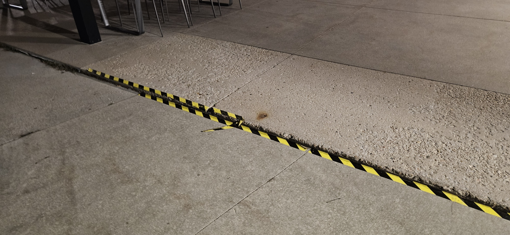 | 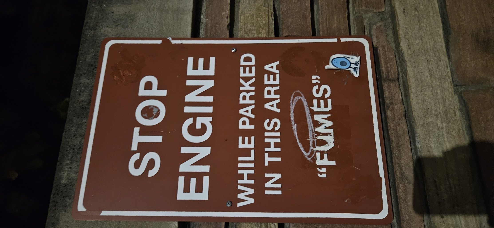 | 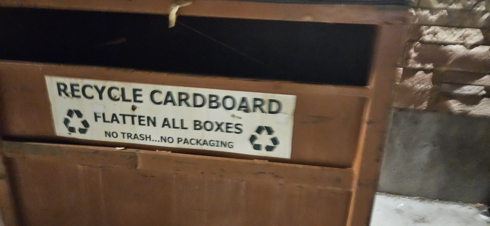 | 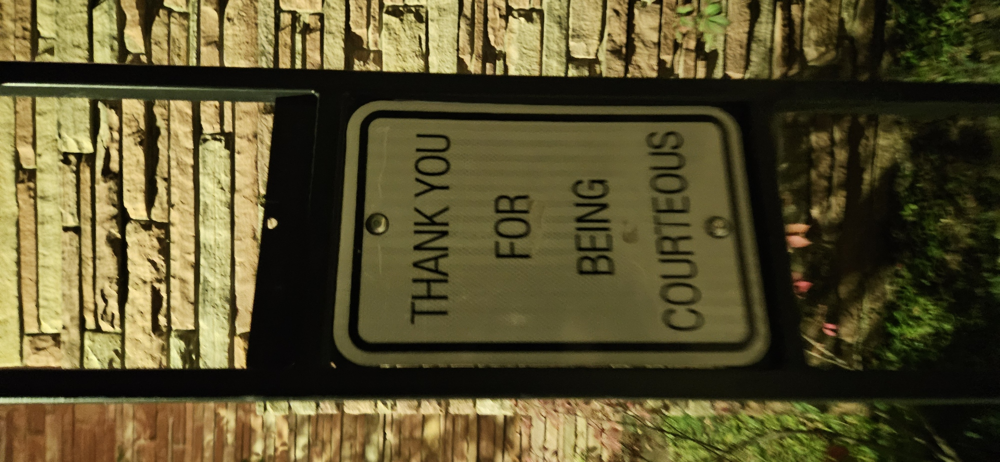 | 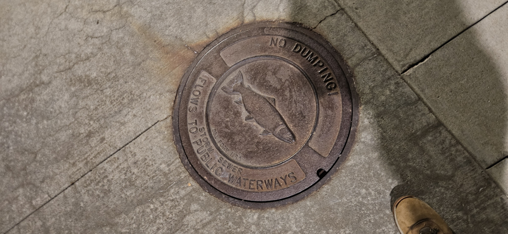 |
| Presumably multiple people tripped over this small step, so hazard tape needed to be added. | This one is just funny. Seems like fumes were an issue with running cars in this area, but not sure why? | The difference between trash, composting, and recycling is always annoying to figure out. This specific sign is for a cardboard-only recycling bin, telling people to break down boxes since presumably most people weren't. | People didn't know they were being courteous, so this sign helps them know. Or, maybe they weren't and it's a passive-aggressive sign? | The fish and "no dumping" text are stamped on to show that whatever goes in ends up in a waterway, so people stop throwing shit in it. |

### 🔒Forcing Functions

_What interaction each one forces._

{: .examples}
| Exit only door | Garage clearance bar | Generator bollard | Diamond plate cover | Downspout drainage channel |
| --- | --- | --- | --- | --- |
| 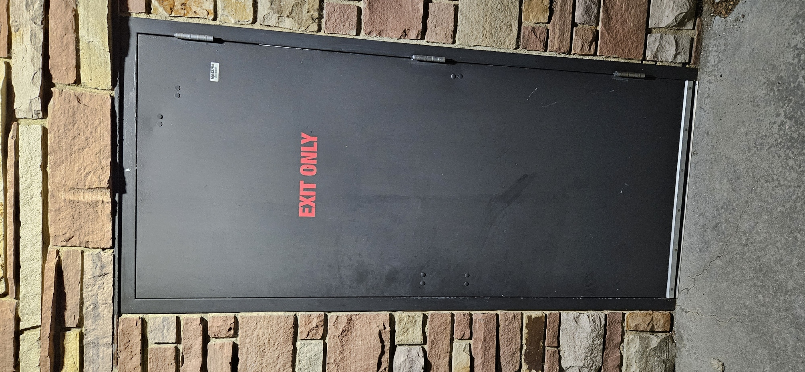 | 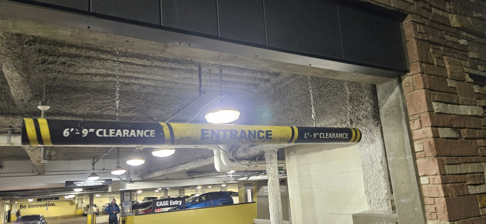 | 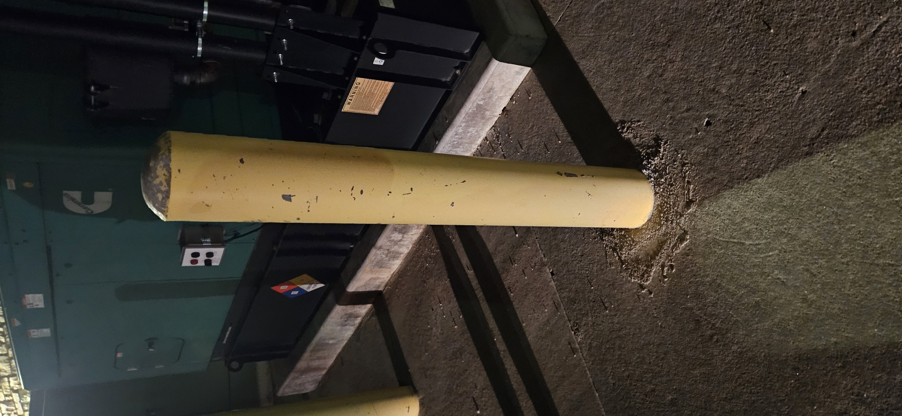 | 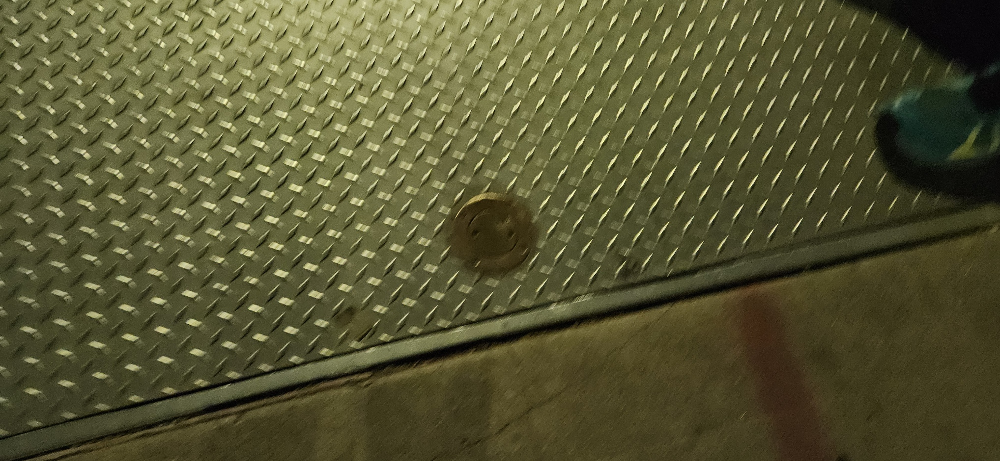 | 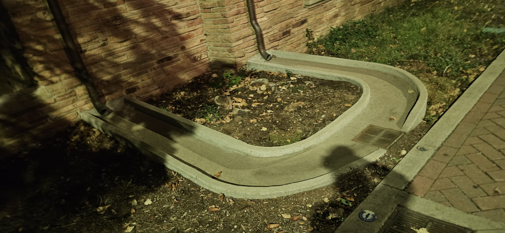 |
| With no handle on the outside, the door can only be opened from inside, so it can only ever be used as an exit. | The bar hangs at the garage's clearance height, so a vehicle that's too tall hits the bar before it can hit the ceiling inside. | The bollards physically keep vehicles from getting close enough to hit the generator. | The round lock set into the plate means the cover can only be opened with the right key or tool, so nobody can casually lift it. | The concrete channel forces rainwater from the downspouts to run to the drain instead of pooling against the building. |

## ✏️Part 2: Prototypes

> ⚠️Side note: To get screenshots for documentation and out of a little curiosity, I went to Google Street View for each of the items I ended up choosing, and each had a VERY telling thing about it, which really helped enlighten some information as to the decisions.

### 🚪False Affordance: The Sliding Steel Flap

Since I really didn't have a better option for this one, I did the sliding steel flap. As mentioned, it doesn't have any sort of stopper to prevent it from sliding off, leading to what I can assume are many instances of maintenance and cleaning staff having to place it back on. Funnily enough, there's evidence of this on Google Maps; the Google Street View for this area shows the flap completely off and set off to the side:

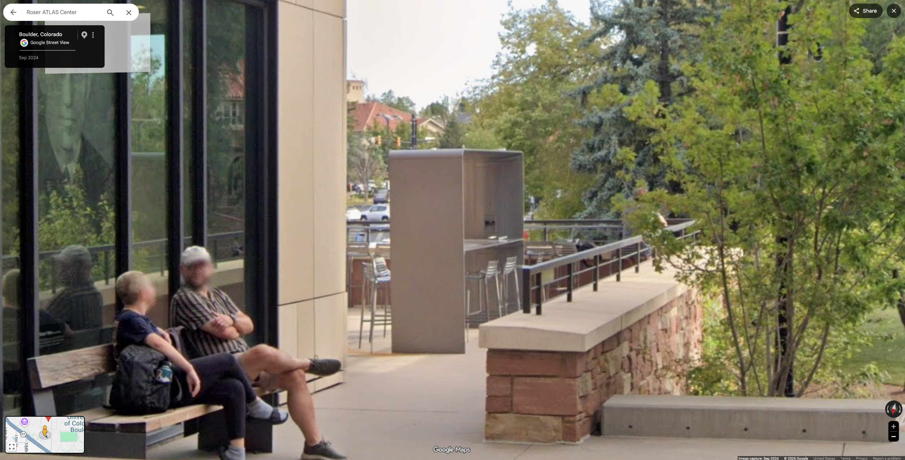
_The charging station on Street View, September 2024. [See on Google Maps](https://www.google.com/maps/@40.0062669,-105.2703468,1654a,15y,165.74h,88.3t/data=!3m7!1e1!3m5!1shesP-YEn4J937Lzjrr4t-g!2e0!6shttps:%2F%2Fstreetviewpixels-pa.clients6.google.com%2Fv1%2Fthumbnail%3Fcb_client%3Dmaps_sv.tactile%26w%3D900%26h%3D600%26pitch%3D1.696946202859749%26panoid%3DhesP-YEn4J937Lzjrr4t-g%26yaw%3D165.74044415848027!7i16384!8i8192?entry=ttu&g_ep=EgoyMDI2MTAyMC4wIKXMDSoASAFQAw%3D%3D)_

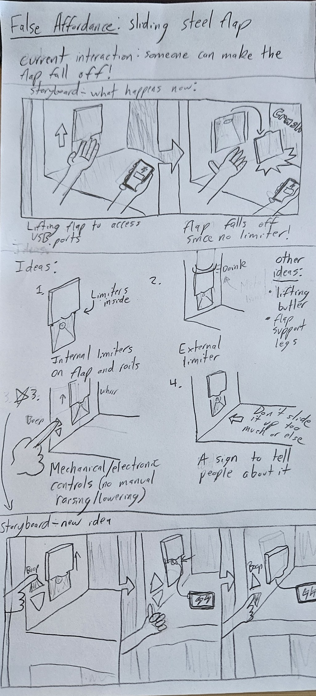
_Sketches: a storyboard of the current interaction, four concepts, and a storyboard of the new idea._

My ideas were:

1. **Internal limiters:** tabs inside the flap and rails that stop it before it slides off.
2. **External limiter:** a stopper on the outside of the rails that the flap bumps into.
3. **Button controls:** electronic up/down buttons, so the flap is never raised or lowered by hand.
4. **A sign:** a warning telling people not to slide the flap up too far.

I ended up choosing #3, which are the button controls. Instead of sliding the flap by hand, you press an up or down button, and a motor raises the flap to a set height and stops it there. Since your hand never touches the flap, there's no way to push it off the rails, and removes any manual input from the flap. Admittedly, this isn't the most minimal intervention (that would be the internal limiters), but limiters can still be forced or broken, while buttons take the hand out of the equation entirely.

### 🏷️Augmented Signifier: The "Stop Engine" Sign

This one was just so funny to me, I couldn't NOT do it. "FUMES" in big blocky letters (almost sounds sarcastic), and also ONLY here; I can't recall ever seeing a sign like this ANYWHERE. Why only here? How would a car or truck even park in this place, since it's above a sidewalk on a small street where you can't really idle or park?

Looking into it, the building it's attached to (which I couldn't find an official name for, but I think is the CMCI Department of Information Science Building) has a "fragrance-free" policy; several sources (such as [this](https://calendar.colorado.edu/technology_learning_center), [this](https://oit.colorado.edu/about-oit/contact-locations/fragrance-free-initiative/resources), and [this](https://oit.colorado.edu/about-oit/contact-locations/fragrance-free-initiative)) all point to this fact. Additionally, the Google Street View for this street was taken in 2017 (almost 10 years ago!), and the sign was there as well:

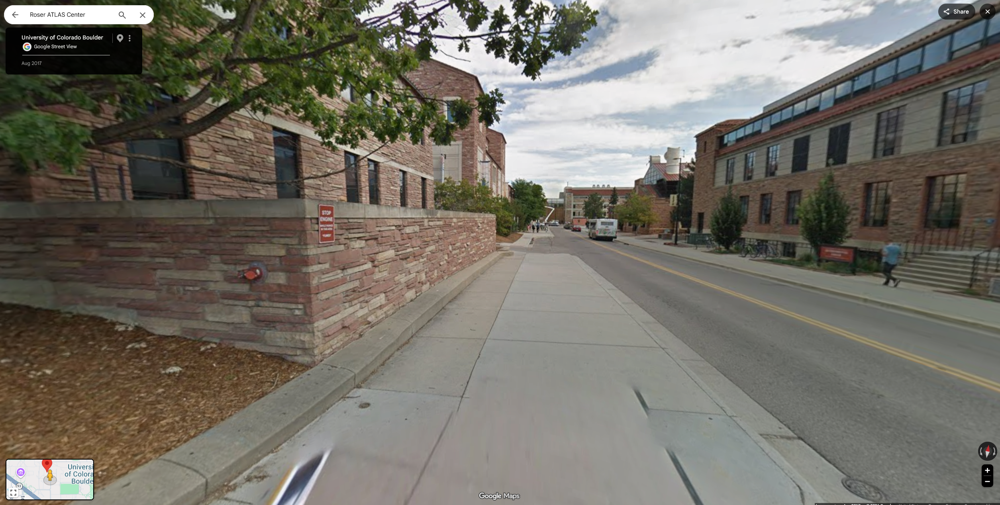
_The sign on Street View, August 2017. [See on Google Maps](https://www.google.com/maps/@40.0068161,-105.2696063,1650a,75y,349.99h,83.3t/data=!3m7!1e1!3m5!1sgW00HEzBtTPv4DJ5w9wavg!2e0!6shttps:%2F%2Fstreetviewpixels-pa.clients6.google.com%2Fv1%2Fthumbnail%3Fcb_client%3Dmaps_sv.tactile%26w%3D900%26h%3D600%26pitch%3D6.699399115792303%26panoid%3DgW00HEzBtTPv4DJ5w9wavg%26yaw%3D349.9893052342442!7i13312!8i6656?entry=ttu&g_ep=EgoyMDI2MTAyMC4wIKXMDSoASAFQAw%3D%3D)_

...which, besides feeling a little bad about finding the sign funny, shows that this building policy has presumably existed for a fairly long time. Generally, these policies are put in place for people with chemical sensitivities, asthma, or other lung conditions, so presumably there's someone who worked/works there who has a condition like this.

All that said, I still don't know how a car could park on this street with the engine on, but whatever.

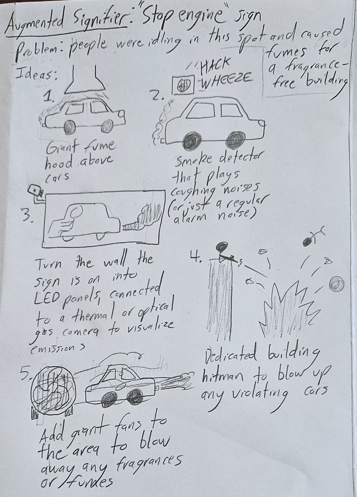
_Sketches: five concepts for removing the need for the sign._

My ideas were:

1. **Giant fume hood:** a hood above the parking spot that sucks exhaust up and away from the building.
2. **Coughing smoke detector:** a detector that plays coughing and wheezing noises (or just a regular alarm) when it picks up exhaust.
3. **Emissions wall:** turn the wall the sign is on into LED panels hooked up to a thermal or optical gas camera, so drivers can see their own exhaust.
4. **Building hitman:** a dedicated hitman to blow up any violating cars.
5. **Giant fans:** fans that blow any fumes or fragrances away from the area.

I did go a bit nonsensical with some of the ideas, but ended up selecting #1, the giant fume hood. A hood over the spot where cars stop pulls exhaust up and away before it reaches the building. If the fumes never get to the building, nobody needs to be told to turn off their engine, so the sign isn't needed anymore.

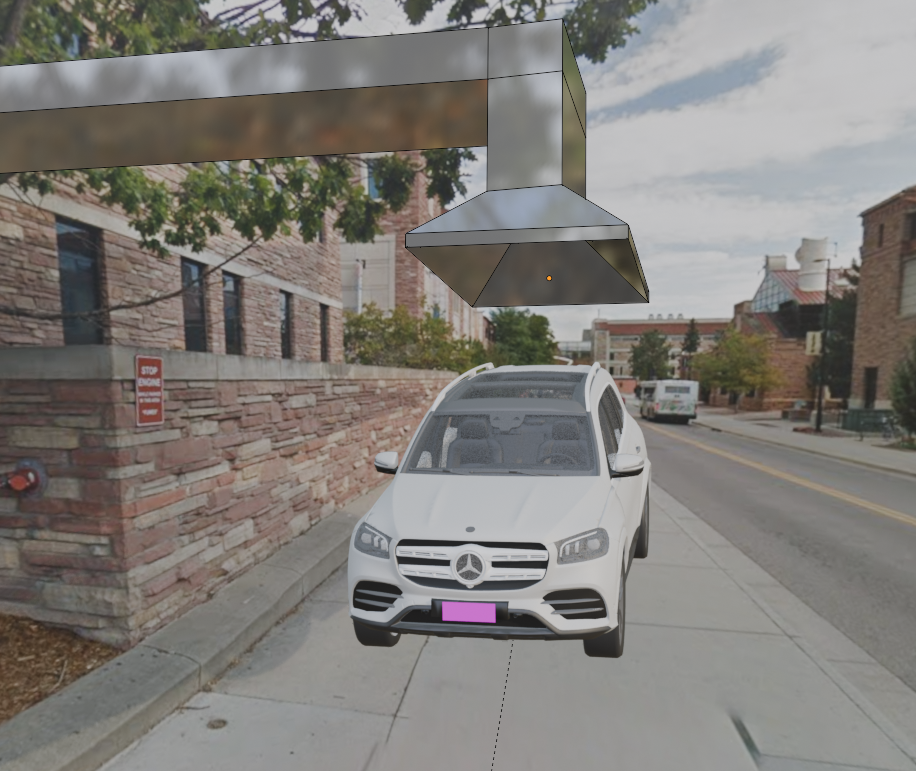
_Blender mockup: an exhaust hood over the curb, pulling fumes up and away from the building._

### 🔒Forcing Function: The Garage Clearance Bar

I ended up choosing the clearance bars for the _Center for Academic Success & Engagement_'s parking garage along Euclid Ave. Google Street View once again has an interesting story here, since evidently as recently as September 2024 the height was 8'2":

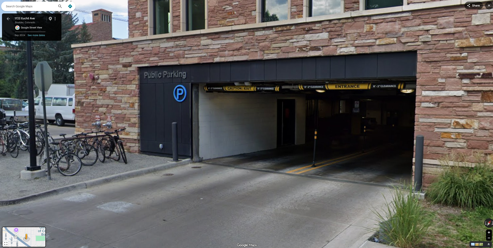
_The garage entrance on Street View, September 2024. [See on Google Maps](https://www.google.com/maps/@40.0059688,-105.2705335,1651a,34.3y,326.32h,86.07t/data=!3m7!1e1!3m5!1s_zuOqKldNEw9UbvsXMorGA!2e0!6shttps:%2F%2Fstreetviewpixels-pa.clients6.google.com%2Fv1%2Fthumbnail%3Fcb_client%3Dmaps_sv.tactile%26w%3D900%26h%3D600%26pitch%3D3.926440219223579%26panoid%3D_zuOqKldNEw9UbvsXMorGA%26yaw%3D326.3228951870043!7i16384!8i8192?entry=ttu&g_ep=EgoyMDI2MTAyMC4wIKXMDSoASAFQAw%3D%3D)_

...which is pretty considerably shorter than 6'9" shown in the image! However, [this article](https://www.colorado.edu/today/2017/02/28/euclid-parking-garage-reopen-march-1) from 2017 talks about the garage re-opening:

> The clearance height of the EPG entrance will be 8 feet, 2 inches. Clearance height for the ramp and both lower levels will be 6 feet, 9 inches.

So, presumably what happened is, sometime between September 2024 and now, someone in a pickup truck (or other tall vehicle) got through the original clearance bar, but tried to go to the ramp/lower levels and got stuck. Since it is confusing for the garage to have varying levels of clearance (at least, IMO), the easiest solution was to make the clearances consistent. Thus, lowered 6'9" clearance.

However, the assignment isn't asking for the reason the clearance bar was lowered; it's asking for why a clearance bar is there in the first place. Not the same, but they're tied together for sure.

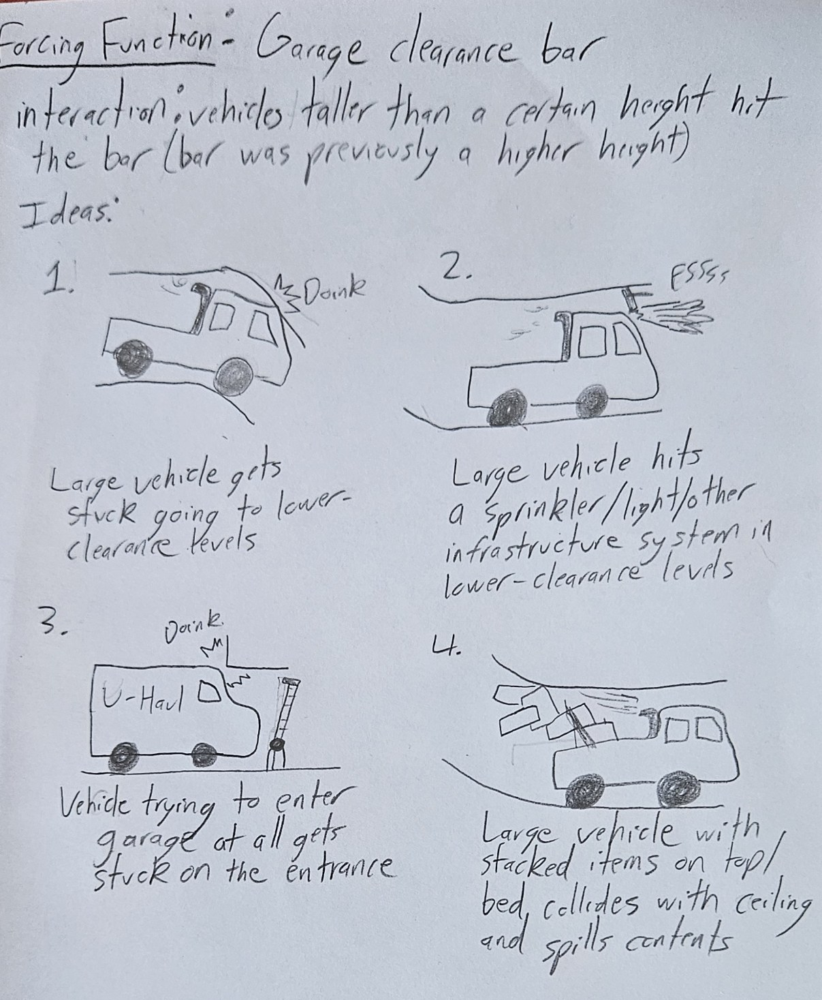
_Sketches: four scenarios that could require the clearance bar._

My ideas were:

1. **Stuck on the ramp:** a tall vehicle makes it in but gets stuck heading down to the lower-clearance levels.
2. **Infrastructure damage:** a tall vehicle hits a sprinkler, light, or other system hanging from the lower-clearance ceilings.
3. **Stuck at the entrance:** a vehicle like a U-Haul gets stuck on the entrance itself.
4. **Spilled cargo:** a vehicle with items stacked on its roof or bed hits the ceiling and spills everything.

I ended up doing a mix of #3 and #4 for this one, where someone's truck clears the entrance, but their cargo doesn't, and topples out onto the driveway.

<video src="img/garage-narrative.mp4" poster="img/garage-narrative.jpg" controls muted playsinline preload="none"></video>
_Blender animation: a Cybertruck hauling The Thinker heads into the garage, and the statue is too tall for the entrance._

## 💭Reflection

_Will fill out after critique!_
