[← All weeks](../)

**Contents**

<!-- prettier-ignore -->
* TOC
{:toc}

## 📝Brief

_In pairs, design a floor plan for a spatial experience: **the Hot Dog Bar at the 2026 Whaaat!? Festival.** Deliver:_

- _A to-scale map of the ATLAS Institute lobby, with table locations, traffic flow, and notes detailing particular places of interest or focus._
- _A comprehensive list of condiments, and how they are laid out on the bar._
- _Each person develops a concept for 1 "specialty" combination, with a sign that demonstrates to visitors how this hot dog should be built._
- _A concept for some sort of unique voucher, achievement, or playful challenge related to the hot dog bar._

**Constraints:** _Two hot dog rollers (30 dogs each) dispense the sausages. Plan to feed 75 people during lunch, 12:30-1:30. Include considerations of multi-sensory design._

**Partner:** Pierce

**Design file:** [Open in Figma ↗](https://www.figma.com/design/gbRaMirAU8nXXbIkg7GQeE/%F0%9F%8C%ADWeek-9---Hot-Dog-Bar?node-id=0-1)

---

## 🎩Concept: A Black-Tie Hot Dog Bar Gala

For the [_Whaaat!? Festival_](https://whaaat.io/), rather than make the hot dog bar be a disorganized, cluttered, self-serve proletariat free-for-all, we want to "offload" the stress of building a hot dog. Thus, we're offering the most luxurious and elegant hot dog experience possible, with a server to build the dog and bring it to the guest. Guests can mingle and enjoy the festival, while servers handle the logistics of building and delivering hot dogs. We build on that with a cocktail-style layout, specialty toppings, and a playful mystery challenge.

Cocktails are part of the experience too. Alongside their dog, guests 21 and over can order our specialty dog: a hot dog cocktail. Servers check ID before taking a cocktail order.

## 🗺️Floor Plan

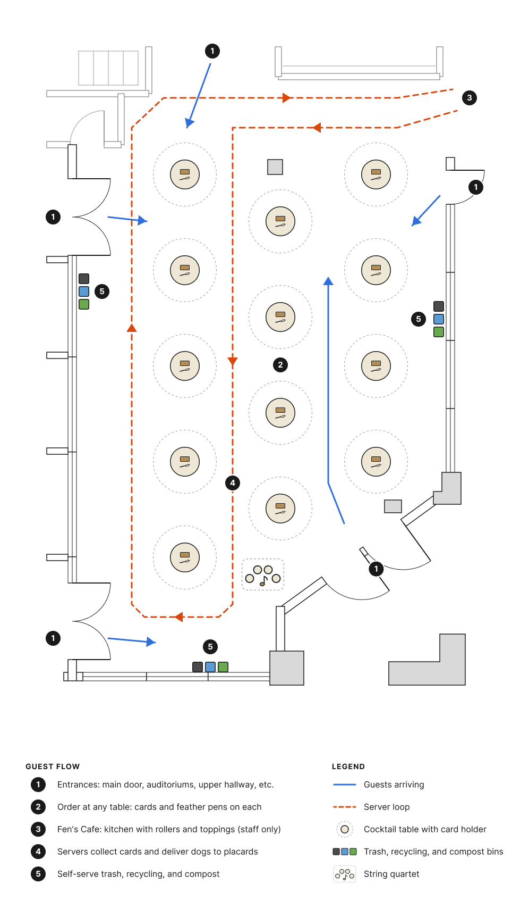
_The ATLAS lobby floor plan for the hot dog bar._

The lobby is set up cocktail-style, with 13 small standing tables in a staggered layout. This encourages the guests to mingle, making the most of their time at _Whaaat!?_ instead of having to make their own hot dog and sit in a dedicated seat. Since guests won't be sitting down, the tables are spaced to allow servers to move freely and avoid bottlenecks. The two hot dog rollers are located in a "kitchen" area, where servers can build the hot dogs and hand them out to guests. Each table has a brass card holder, with several order cards, and a few feather pens, where guests can fill out a card with their desired toppings. A server will then pick up the card and bring it to the "kitchen", where the hot dog is built and delivered to the guest, based on the numbered placard at their table.

### 🚶Guest Flow

1. **Entrances:** Guests can arrive from any side: the building's main entrance at the lower right, the doors from the surrounding auditoriums and rooms, or the hallway at the top. Because cards wait on every table, there's no single starting point to crowd, so guests can go to whatever table they want.
2. **Order at any table:** Every table has a brass card holder with order cards and gold-ink feather pens (ballpoint pens in a quill shape). Guests fill out their desired hot dog configuration, and a server will come by to collect the order card, check their ID if they ordered a cocktail, and verify their "status" (tier); once this is done, the server provides a numbered placard, fills in the order number, and takes the card to the "kitchen" in Fen's Cafe. For visually-impaired guests, servers can read the card aloud and take the order by voice instead.
3. **Fen's Cafe (staff only):** Fen's Cafe is where the rollers and toppings are. Servers come here to build the hot dogs, based on order cards. The rollers are reloaded as dogs come off, so a fresh batch is always heating. If a guest ordered a cocktail, it's mixed here as well.
4. **Delivery:** Finished dogs leave Fen's on a covered tray (cloche) with their card, and servers then deliver the hot dog to the guest, based on the number on the placard, lifting the cover at the table (see Smell below). Cocktails ride along on the same tray, already sitting on their coaster (see Build Sign below). The placard is collected for reuse. If a placard can't be found, the server calls out the guest name written on the order card instead.
5. **Trash:** Since the servers will already be busy enough as-is, trash is self-serve. There's three spots spread around the room so no single spot gets crowded.

Since ordering happens at the tables, there's no line for guests to wait in and no line to bottleneck.

This setup being very server-driven definitely presents its own challenges; there could literally be "too many cooks in the kitchen" building hot dogs, and have its own bottleneck. Also, the servers (6-8 total) would have LOTS of constant responsibility, including:

- Collecting order cards
- Checking IDs for cocktails
- Checking "tier" status for Noble toppings
- Restocking order cards on tables
- Placard collection and reuse
- Building hot dogs
- Mixing the cocktail
- Delivering hot dogs and cocktails to guests
- Collecting trash, if overflowing

...but the benefits of this setup outweigh the challenges IMO. And servers would hopefully be able to make hot dogs quickly and efficiently by following the order card, and the layout in Fen's Cafe would be designed to make it simple for the servers (see below).

## 🌭Condiments and How They're Organized

There's a metric poopload of toppings available for the hot dogs. After all, _Whaaat!?_ likes its glizzies.

Since servers are making the hot dogs instead of guests, the bar layout becomes twofold: organizing the condiments on the order card (for guests), and arranging the condiments in the kitchen (for servers). Being themed as a black-tie fancy gala, the toppings are organized into social status tiers, based both on the "fanciness" of the toppings, and the "profession" of a person where the topping might have come from. This can be seen on the order card, which is laid out in two columns with the toppings organized in this way:

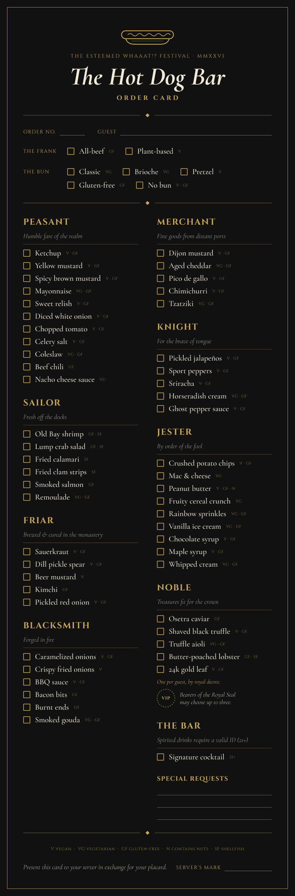
_The order card._

At the top of the card, guests choose their frank (all-beef or plant-based) and bun (classic, brioche, pretzel, gluten-free, or none), then check off toppings by tier. The tiers are as follows:

| Tier       | Motto                           | Toppings                                                                                                                                                         |
| ---------- | ------------------------------- | ---------------------------------------------------------------------------------------------------------------------------------------------------------------- |
| Peasant    | Humble fare of the realm        | Ketchup, yellow mustard, spicy brown mustard, mayonnaise, sweet relish, diced white onion, chopped tomato, celery salt, coleslaw, beef chili, nacho cheese sauce |
| Sailor     | Fresh off the docks             | Old Bay shrimp, lump crab salad, fried calamari, fried clam strips, smoked salmon, remoulade                                                                     |
| Friar      | Brewed & cured in the monastery | Sauerkraut, dill pickle spear, beer mustard, kimchi, pickled red onion                                                                                           |
| Blacksmith | Forged in fire                  | Caramelized onions, crispy fried onions, BBQ sauce, bacon bits, burnt ends, smoked gouda                                                                         |
| Merchant   | Fine goods from distant ports   | Dijon mustard, aged cheddar, pico de gallo, chimichurri, tzatziki                                                                                                |
| Knight     | For the brave of tongue         | Pickled jalapeños, sport peppers, sriracha, horseradish cream, ghost pepper sauce                                                                                |
| Jester     | By order of the fool            | Crushed potato chips, mac & cheese, peanut butter, fruity cereal crunch, rainbow sprinkles, vanilla ice cream, chocolate syrup, maple syrup, whipped cream       |
| Noble      | Treasures fit for the crown     | Osetra caviar, shaved black truffle, truffle aioli, butter-poached lobster, 24k gold leaf                                                                        |

You may have noticed the VIP stamp by the Noble tier. This comes from the various passes that guests can have:

| Pass                      | At the hot dog bar                                                                                |
| ------------------------- | ------------------------------------------------------------------------------------------------- |
| Hero of the Microrepublic | The Royal Seal: up to three Noble toppings, and their personal herald announces the dog's arrival |
| Citizen                   | The full menu, with one Noble topping                                                             |
| Tourist                   | Lunch is available as an add-on                                                                   |
| Travel Waiver             | Same as Tourist                                                                                   |

Citizen and Hero passes come with a _Whaaat!?_ passport, which is how servers verify status. When a server collects an order card, they stamp a "Hot Dog Bar" page in the guest's passport, which confirms their pass and keeps anyone from ordering twice. For Heroes, the server also stamps the VIP seal on the card, so the kitchen knows to allow up to three Noble toppings.

As mentioned above, the condiment bar technically still exists behind-the-scenes in Fen's Cafe, where only servers use it. The condiments are set up in a line, in the same order as the order card, so servers can just follow the card down the line for linear, intuitive hot dog assembly:

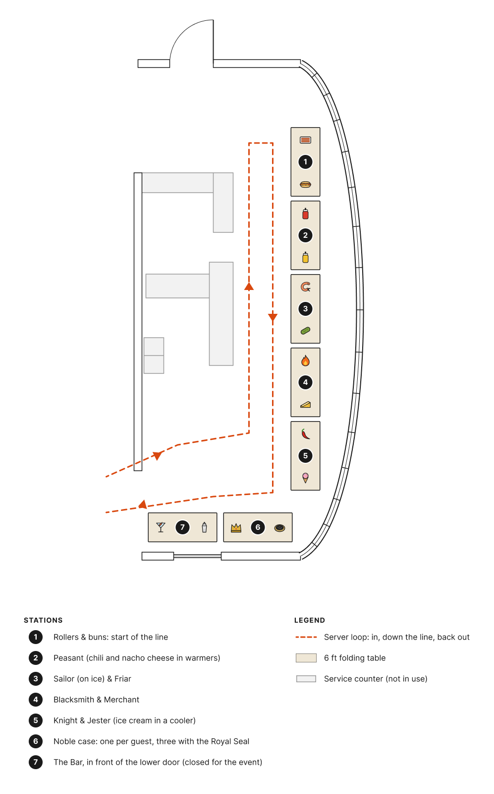
_Fen's Cafe, set up as the kitchen. Stations follow the order card, from the rollers to the Noble case and the bar._

The order card also tags each topping as vegan, vegetarian, gluten-free, containing nuts, or shellfish, so guests with dietary needs can check before they order, or mention it on their "Special Requests" on the order card. On the line, peanut butter and the shellfish each get their own utensils, so they don't cross-contaminate other toppings.

## ⭐Specialty Dog: _The Old Frankshioned_

> ⚠️**DISCLAIMER**: Obviously, the _Whaaat!?_ Festival is an all-ages, family-friendly event, and does/would not serve alcohol. This is a playful concept for IF the festival were to serve cocktails for all guests 21 and over.

The ask here is for a hot dog _bar_, so naturally, a bar should have alcoholic beverages for us alcoholics. Thus, we have a specialty hot dog cocktail, perfect to pair with whatever glizzy you end up ordering.

Meet _The Old Frankshioned_: a hot dog flavored Old Fashioned. It's built on whiskey that's been infused with actual hot dogs, with a splash of Doritos liquor and pickle shot to really round out the ballpark flavors. An Old Fashioned is the classic black-tie whiskey (or bourbon) drink, which fits the gala theme, and it's spirit-forward, so the hot dog infusion is front and center. To cut down on preparation time, the cocktail is pre-batched, so servers just pour it over ice and add the garnish, rather than having to mix it from scratch for each order.

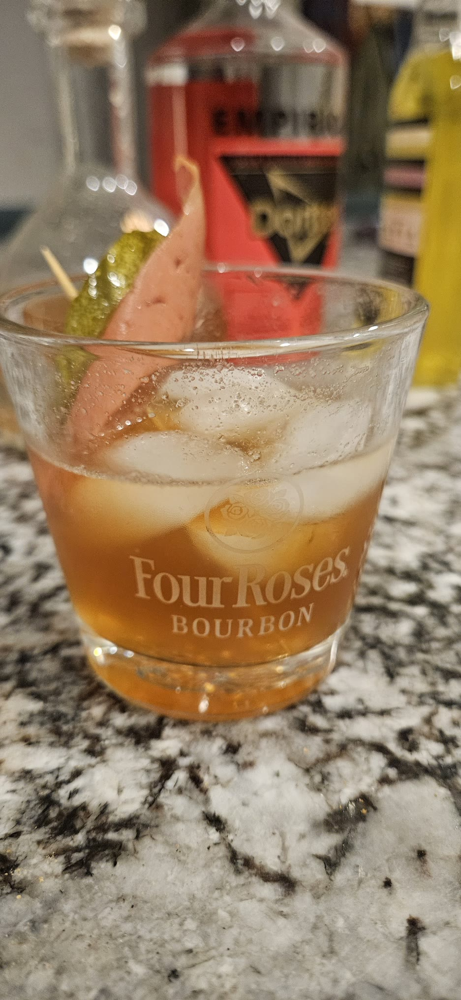

### 🍸The Recipe

**Ingredients:**

- 1½ oz hot dog-infused whiskey (see below)
- ½ oz [Empirical x Doritos Nacho Cheese](https://woodencork.com/collections/liqueur-more/products/doritos-x-empirical) liquor
- 1 bar spoon (about ¼ oz) pickle shot liquor
- 1 bar spoon (about ¼ oz) maple syrup
- 2 dashes Angostura bitters

**Instructions:**

1. Add everything to a mixing glass with ice.
2. Stir for about 30 seconds, until cold.
3. Strain over one large ice cube in a rocks glass.
4. Garnish with a cocktail glizzy and a mini pickle on a toothpick.

### 🧪The Creation Process: Infusion and Mixing

The base of the cocktail is a homemade hot dog-infused whiskey:

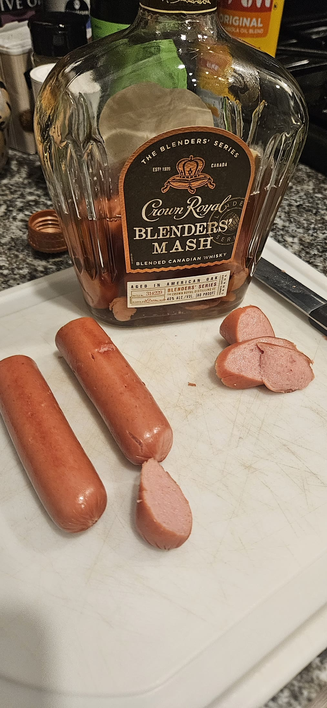
_Crown Royal Blenders' Mash, loaded with hot dog._

To make this, I first boiled the glizzies to cook them through, then seared them in a pan for some extra flavor. After slicing them into small coins, I fed them into a bottle of whiskey. I used Crown Royal Blenders' Mash since I had it on hand (thank you Jay), but any whiskey will do; infusions tend to do better with higher-proofs, so my personal recommendation is Wild Turkey 101. The bottle then steeped for 24-48 hours, allowing the hot dog flavor to dissolve into the whiskey.

  
View the infusion process

  

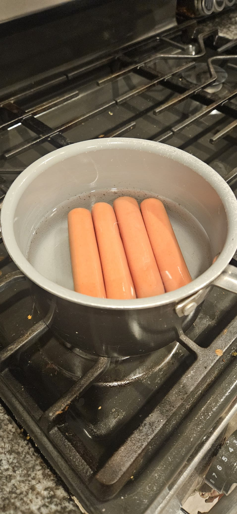
_Step 1: Boiling the glizzies to cook them through._

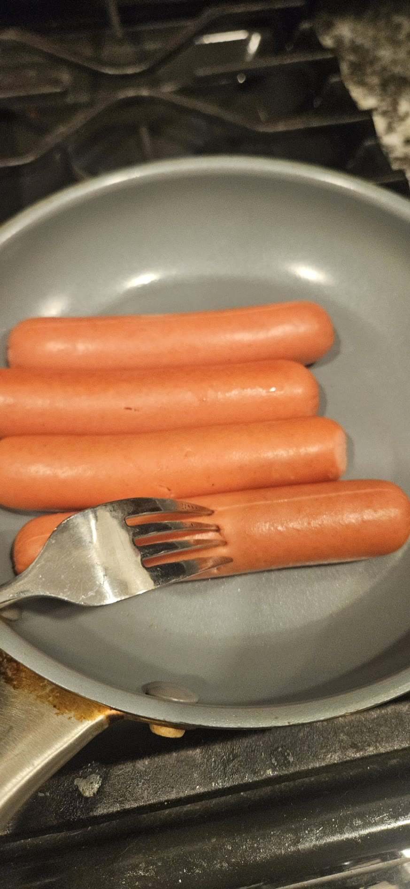
_Step 2: Searing the glizzies in a pan for some extra flavor._

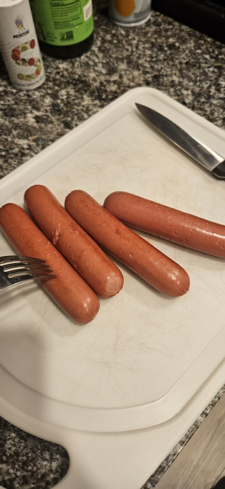
_Step 3: The cooked glizzies, ready for slicing._

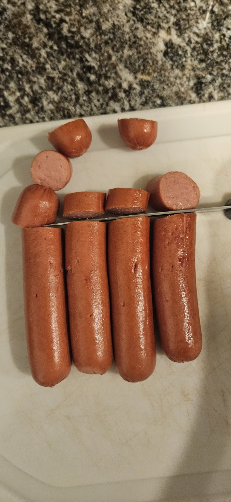
_Step 4: Slicing the glizzies into coins, small enough to fit through the bottle's neck, with more surface area for the whiskey to soak into._

<video src="img/infusion-step-5-bottling.mp4" poster="img/infusion-step-5-bottling.jpg" controls muted playsinline preload="none"></video>
_Step 5: Feeding the coins into the bottle, one by one._

_Step 6: The bottle, fully loaded._

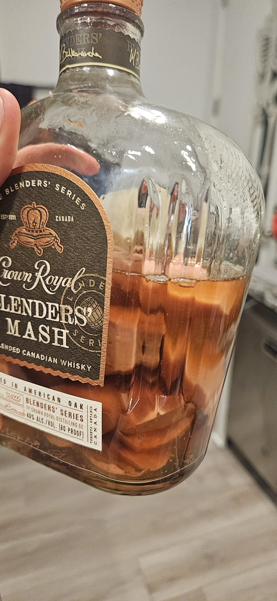
_Step 7: Steeping in the whiskey._

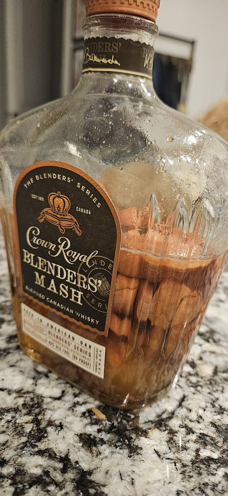
_Step 8: Done infusing._

<video src="img/infusion-step-9-inspecting.mp4" poster="img/infusion-step-9-inspecting.jpg" controls muted playsinline preload="none"></video>
_Step 9: A closer look at the glizzy coins after infusing._

<video src="img/infusion-step-10-straining.mp4" poster="img/infusion-step-10-straining.jpg" controls muted playsinline preload="none"></video>
_Step 10: Straining the whiskey into a decanter, leaving the glizzies behind._

  

Once it was done infusing, I strained the whiskey through a funnel strainer into a decanter (empty bottle).

**Optional:** For a cleaner, less greasy whiskey, it can also be fat-washed: freeze the strained whiskey for a few hours so any fat from the glizzies solidifies on top, then strain it again through a coffee filter. I didn't because I'm lazy and wanted the full hot dog flavor, but if you want your hot dog liquor to be transparent and not cloudy, this is the way to go.

With the hot dog whiskey ready, I made a prototype of The Old Frankshioned at home, following the recipe above:

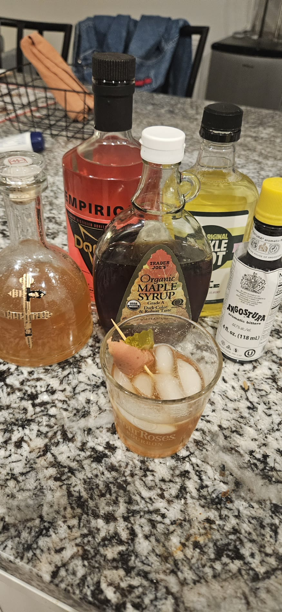
_The Old Frankshioned prototype, with everything that went into it._

  
View the making process

  

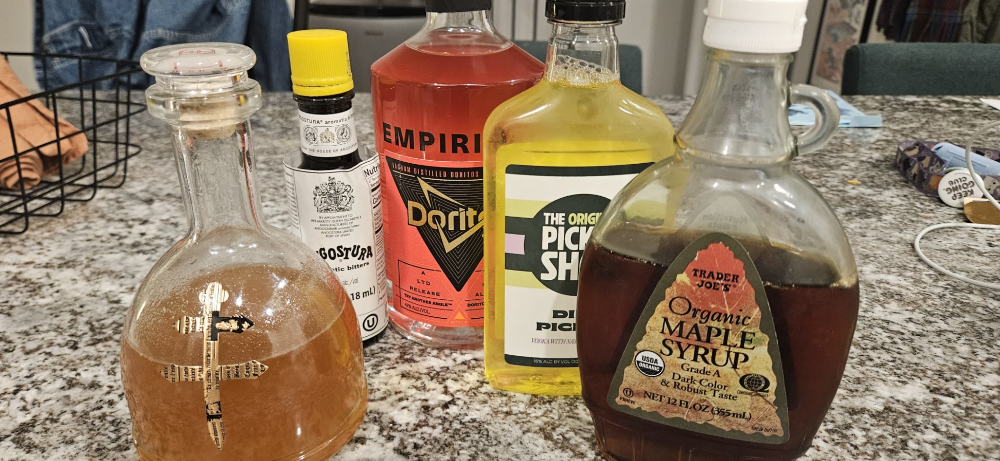
_Step 1: The ingredients: the hot dog whiskey (in a decanter), Angostura bitters, Empirical x Doritos, The Original Pickle Shot, and maple syrup._

<video src="img/prototype-step-2-mixing.mp4" poster="img/prototype-step-2-mixing.jpg" controls muted playsinline preload="none"></video>
_Step 2: Measuring each ingredient into the glass over ice, then stirring._

_Step 3: Garnished with a glizzy and a pickle on a pick._

  

### 🪧Build Sign: The Coaster

Since the cocktail is pre-batched, guests never actually see it get built; it just shows up at their table. So instead of a sign at the bar, the "sign" is the coaster the drink is served on. It rides out on the cloche tray with the glass already sitting on it, so the answer to "wait, what am I drinking?" is right there when the guest asks it. It's also theirs to keep, so it doubles as a take-home souvenir.

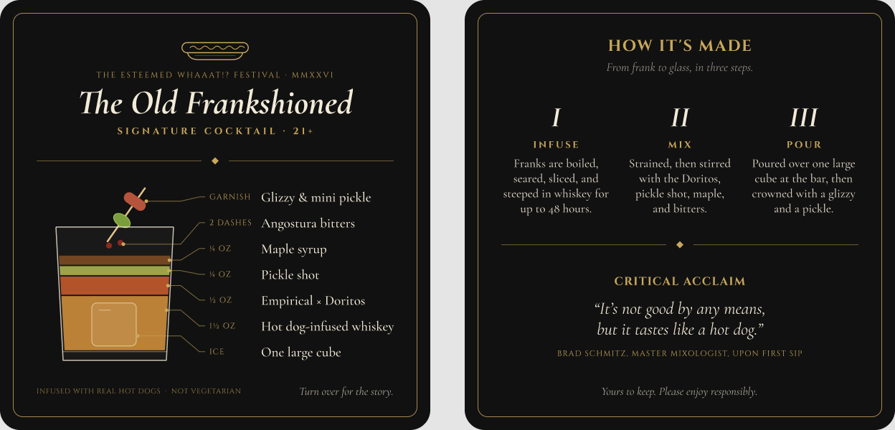
_The coaster, front (left) and back (right)._

It's a 4" square coaster in the same black-and-gold style as the order card and placard:

- **Front, the build:** An exploded diagram of the glass, with each ingredient drawn as its own layer, to scale (the 1½ oz of whiskey is six times the height of the ¼ oz pickle shot), and labeled with its pour. The bitters, ice, and garnish get called out too. This is what "demonstrates how it should be built", since guests can see the whole recipe at a glance, even though nobody stirred it in front of them.
- **Back, the story:** The three steps from frank to glass (infuse, mix, pour), plus "Critical Acclaim," a pull quote from my honest reaction to the first sip (see below).
- **Dietary note:** Matching the dietary tags on the order card, the front flags that it's infused with real hot dogs and isn't vegetarian, which nobody would guess from looking at a whiskey drink.

### 👅Tasting Notes

<video src="img/prototype-step-4-tasting.mp4" poster="img/prototype-step-4-tasting.jpg" controls muted playsinline preload="none"></video>
_The first sip._

I was all geared up to use the "It tastes like burning!" clip by Ralph Wiggum from _The Simpsons_ as a reaction to the first sip, but it was a resounding... not terrible. It's not good by any means, but it tastes like a hot dog thanks to the combo of infused whiskey, Doritos liquor, and pickle shot, so... lives up to the name. It's a weird mix of sweet and salty/briny, and doesn't particularly strike me as being an Old Fashioned variant, but it'd at least would be a fun thing for people to try at the festival.

## 🕵️Voucher / Challenge: Clue-Style Hot Dog Deduction

Our challenge is a Clue-style mystery. At the beginning of the event, it's announced that Danny, the _Whaaat!?_ organizer and hot dog lord, has placed one very specific hot dog order, and guests must deduce what it is, based on Danny's life story. Clues to it are scattered across the _Whaaat!? Festival_: at speaker talks, events, within student-developed games, and locations around the Roser ATLAS Center. Each clue rules out part of the order, like the frank, a whole tier, or a single topping. Guests who work out the exact order check it off on an order card and hand it to a server as their guess.

Anyone who orders the very same dog as Danny receives the _Great Minds Frank Alike_ award, delivered on the cloche tray alongside their dog, and signed and dated by Danny. Whoever matches Danny's order first is also henceforth known as the "Glizzy Sleuth" for the rest of the event.

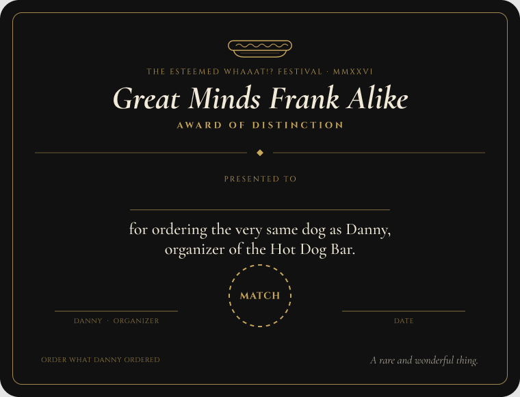
_The Great Minds Frank Alike award, presented to guests who match Danny's order._

To keep the mystery from getting in anyone's way, every clue hides in something the festival already hands out or shows, rather than on new signage. Each one is marked with the same small gold hot dog emblem from the top of the order card, so players learn to spot them, while everyone else just sees a cute logo. Where possible, the clue also matches its location (the cereal clue lives at the cereal breakfast, for example). Any clue that's essential to solving the mystery lives somewhere every pass type can reach, since Tourists don't get passports.

### 🔍Example Order and Clues

For example, here could be Danny's order, and the clues / snippets of Danny's life story that lead to it:

- **Frank:** All-beef
- **Bun:** Brioche
- **Toppings:** Nacho cheese sauce (Peasant), kimchi (Friar), fruity cereal crunch (Jester)

| Where it's hidden                                                     | Type     | Clue                                                                                                                                          | What it reveals                          |
| --------------------------------------------------------------------- | -------- | --------------------------------------------------------------------------------------------------------------------------------------------- | ---------------------------------------- |
| The card holder on every table, under "Can you order what Danny did?" | Table    | _"Danny is a creature of habit: three toppings, and never two from the same tier."_                                                           | Three toppings, three tiers              |
| A sticker in the festival sticker pack                                | Swag     | _"Danny grew up on the family cattle ranch, and stays loyal to the herd."_                                                                    | All-beef frank                           |
| The "Hot Dog Bar" stamp page in the passport                          | Swag     | _"Danny has humble roots, but expensive taste in bread: nothing without butter and eggs."_                                                    | Brioche bun                              |
| A transition slide in a speaker's talk                                | Speaker  | _"Raised in a landlocked village on a shoestring budget, Danny has never seen the sea. A childhood mishap at the forge left a fear of fire."_ | No Sailor, Blacksmith, or Noble toppings |
| An easter egg in a student-developed game                             | Game     | _"Danny never forgot the minor-league ballpark back home, where everything came smothered in something warm and orange."_                     | Nacho cheese sauce (Peasant)             |
| Fen's Cafe's chalkboard menu, facing the lobby                        | Location | _"As a teen, Danny spent a summer at a mountain monastery outside Seoul, and still craves what the monks kept in clay jars."_                 | Kimchi (Friar)                           |
| The cereal breakfast's sign and napkins                               | Event    | _"Years before organizing the Hot Dog Bar, Danny was a kid glued to Saturday cartoons with a bowl in hand, and still is at heart."_           | Fruity cereal crunch (Jester)            |

## 🎭Multisensory Considerations

### 👃Smell

So, an elephant in the room: with the actual "bar" being inside Fen's Cafe and only accessible to servers, the alluring smell of hot dogs and toppings won't be detectable from the lobby; if it is, not nearly as strong. After all, there's a reason gas stations have hot dog rollers out - to get you hungry by seeing and smelling it. Thus, we have a few options to make the smell more present in the lobby:

1. **Scented candles:** Place some candles on each of the tables, with scents that evoke hot dogs and toppings. This would help make up for not having hot dog rollers directly in the lobby.
2. **Fans:** Install fans in the kitchen that blow the smell of hot dogs and toppings into the lobby, a la what some bakeries do (looking at you, Boudin's Sourdough on Fisherman's Wharf in SF) to entice customers.
3. **Covered serving trays:** Have servers carry the hot dogs on covered trays, and when they arrive at the table, they can lift the cover to reveal the hot dog and its aroma. This would help to create a sense of anticipation and excitement for the guests as well.

### 👅Taste

I think taste is pretty self-explanatory here, since it is a hot dog bar with a wide variety of toppings. The taste of the hot dogs and toppings will be the main focus of the experience, ranging from classic to straight-up unhinged. Each tier has its own flavor profile, so guests can mix and match for some contrast:

- **Peasant:** Tangy, sweet, and salty ballpark classics
- **Sailor:** Briny and buttery seafood
- **Friar:** Sour and fermented
- **Blacksmith:** Smoky, charred, and sweet-savory
- **Merchant:** Bright and herby
- **Knight:** Heat of varying intensity
- **Jester:** Sweet, crunchy, and lowkey fucked up
- **Noble:** Rich, buttery, and savory

### 🤌Touch

There isn't a ton of touch involved with a black-tie served hot dog bar, since users aren't building their own hot dogs. However, the hot dogs themselves do offer a tactile experience. Depending on the bun, choice of toppings, etc., the hot dog can be soft, crunchy, chewy, or even cold (if you get ice cream on it). Cocktail drinkers also get the coaster, a thick card they can pick up, flip over, and pocket on the way out.

### 🎻Sound

Some ideas for improving the audio experience include:

1. **String quartet:** A string quartet plays in the lobby during lunch, just inside the main entrance (see the floor plan) so it's the first thing guests hear, adding to the "classy feel". Since it is for _Whaaat!?_, it would be fun for them to do hot dog related songs (like "Take Me Out to the Ball Game") or video game music in a classical style.
2. **The herald:** When a Hero's dog arrives, their personal herald announces it to the room. Status becomes something the whole lobby can hear, which also doubles as an ad for the Hero pass.

## 💭Reflection

_To be filled out in a few weeks!_
